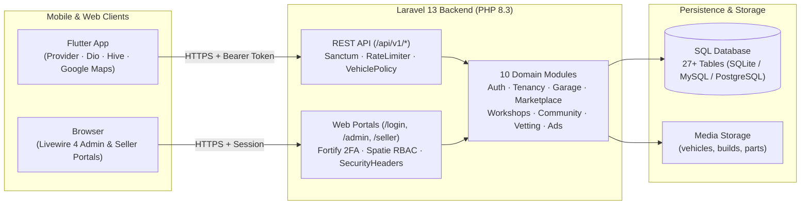

<div align="center">

<!-- Animated Wave Header -->


<!-- Animated Typing SVG -->
<a href="https://github.com/ChaniduMadalagama/ApexGarage-SL-">
  
</a>

<br/>

<!-- Tech & Status Badges -->
-02569B?style=for-the-badge&logo=flutter&logoColor=white)


-16A34A?style=for-the-badge&logo=checkmarx&logoColor=white)


</div>

---

## Overview

**ApexGarage SL** (`apexgarage_sl`) is a full-stack, multi-tenant **Digital Garage & Automotive Performance Platform** tailored for Sri Lanka's car and motorcycle enthusiast community, aftermarket parts merchants, and specialist workshops.

It unifies:
- **Digital Garage & Service Glovebox:** Manage multiple vehicles, log modification build histories with photos, and track odometer-stamped service records.
- **Vetted Parts Marketplace:** Search and filter performance parts with an interactive price-distribution histogram, save listings, reserve stock, and chat directly with sellers.
- **Workshop Bay Booking:** Browse verified mechanics/workshops, inspect open bay slots, and book service appointments.
- **Meets & Live Crew Map:** Explore Colombo-centered meets on `Google Maps`, RSVP to events, create/join crews, and broadcast live riding presence.
- **Dual-Channel Seller & Admin Portals:** Dedicated **Mobile Seller Mode** (`SellerShell`) plus **Livewire 4 Web Portals** (`/seller` and `/admin`) for merchant vetting, listing moderation, and sponsored ad analytics.

---

## System Architecture



---

## Getting Started

### 1. Backend Setup (`backend/`)

```bash
cd backend
composer install
cp .env.example .env
php artisan key:generate

# Run migrations and seed demo accounts, vehicles, parts, workshops, meets & crews
php artisan migrate --seed

# Link public storage for uploaded vehicle/build/part images
php artisan storage:link

# Start the Laravel API & Livewire server
php artisan serve --host=0.0.0.0 --port=8000
```

> **Web Portals:** Once running, open `http://127.0.0.1:8000/login` in your browser to access the **Admin Portal** (`/admin`) or **Seller Portal** (`/seller`).

---

### 2. Flutter Mobile App Setup (Root Directory)

```bash
# Install Flutter dependencies
flutter pub get

# Run Development flavor (point APEX_API_URL to your local machine IP or 127.0.0.1)
flutter run --target lib/main_development.dart --dart-define=APEX_API_URL=http://127.0.0.1:8000

# Staging flavor
flutter run --target lib/main_staging.dart

# Production flavor
flutter run --target lib/main_production.dart
```

<details>
<summary><strong>IDE Launch Configurations (VS Code)</strong></summary>

`.vscode/launch.json` includes preconfigured launch profiles for:
- `Launch development` (`lib/main_development.dart`)
- `Launch staging` (`lib/main_staging.dart`)
- `Launch production` (`lib/main_production.dart`)

</details>

---

## Running Tests & Static Analysis

### Backend Automated Tests (Pest / PHPUnit)

```bash
cd backend
php artisan test
```

Latest verified run:
- **Result:** `17 passed` (`202 assertions`) in `630 ms`
- **Coverage:** `tests/Unit/ExampleTest.php` (`TenantContext`), `tests/Feature/ApexGaragePlatformTest.php` (Livewire portals, RBAC, vetting, moderation, ads, policies, cache invalidation, tenancy), and `tests/Feature/MobileApiTest.php` (`+94` mobile registration, Sanctum auth, IDOR protection, garage CRUD, marketplace chat/histogram/reserve, workshops, meets, live crew presence, Seller API).

### Flutter Static Analysis

```bash
flutter analyze
```

Latest verified run:
- **Result:** `0 errors`, `0 warnings` (`534 info` stylistic/deprecation notices from `very_good_analysis`).

---

## Seeded Demo Accounts

All seeded accounts in `backend/database/seeders/DatabaseSeeder.php` use the password **`password`** *(change before any production deployment)*:

| Role | Email | Password | Access |
| :--- | :--- | :--- | :--- |
| **Super Admin** (`super-admin`) | `admin@apexgarage.lk` | `password` | `/admin` Web Portal + Mobile App |
| **Enthusiast** (`pro-member`) | `dineth@apexgarage.lk` | `password` | Flutter Mobile App (Seeded Cars & Bikes) |
| **Workshop Partner** (`workshop-partner`) | `sales@jdmdirect.lk` | `password` | Mobile Seller Mode + `/seller` Web Portal |
| **Workshop Partner** (`workshop-partner`) | `moto@hillcountry.lk` | `password` | Mobile Seller Mode + `/seller` Web Portal |
| **Workshop Partner** (`workshop-partner`) | `parts@boostyard.lk` | `password` | Mobile Seller Mode + `/seller` Web Portal |

---

## Documentation

Full academic and technical documentation (aligned with `CS6P05ES` Final Project Report structure) is available in [`docs/`](docs/):
- [Final Project Report (Complete)](docs/Final_Project_Report.md)
- [Chapter 5: System Design & ERDs](docs/05_design.md)
- [Chapter 6: Implementation & API Reference](docs/06_implementation.md)
- [Chapter 7: Testing & Verification](docs/07_testing_and_verification.md)

---

<div align="center">
  
</div>
