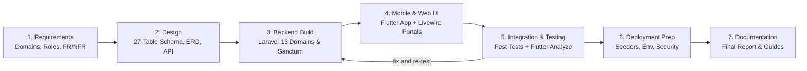
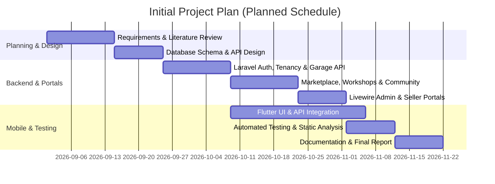
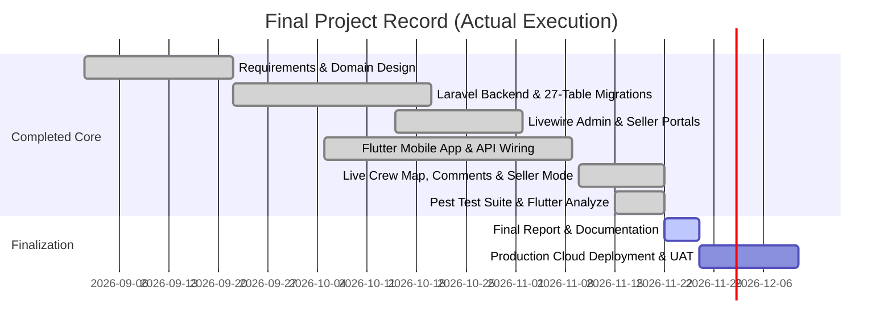

# Chapter 3: Project Management

This chapter describes the project management approach, the initial project plan, the challenges encountered that led to plan adjustments, and the final project record.

---

## 3.1 Approach

An **iterative, phase-based development approach** with a fix-and-retest loop was adopted. Because ApexGarage SL spans two distinct codebases—a cross-platform Flutter mobile client and a Laravel 13 backend with Livewire web portals—building in vertical increments allowed each domain (`Auth`, `Garage`, `Marketplace`, `Workshops`, `Community`, `Seller/Admin`) to be implemented end-to-end and verified with automated tests before moving to the next phase.

*Figure 1: Development methodology — phases with a fix-and-re-test loop*

---

## 3.2 Initial Project Plan

The initial plan structured the work across `[PROJECT_DURATION_WEEKS]` weeks from project proposal through final report submission, prioritizing backend domain modeling and authentication before mobile feature wiring and testing.

*Figure 2: Initial project plan (Gantt chart, planned dates — adjust `[YYYY-MM-DD]` placeholders to match your official schedule)*

*Table 2: Tasks in the initial plan*

| Task | Planned Window | Description |
| :--- | :--- | :--- |
| Requirements & Literature Review | `[PHASE_1_DATES]` | Domain study, stakeholder roles, FR/NFR specification |
| Database Schema & API Design | `[PHASE_2_DATES]` | 27-table relational schema, ERD, `/api/v1` contract |
| Backend Core (Auth, Tenancy, Garage) | `[PHASE_3_DATES]` | Sanctum auth, Spatie RBAC, `TenantScope`, `VehiclePolicy` |
| Backend Commerce & Community | `[PHASE_4_DATES]` | Marketplace, workshops, meets, crews, feed, promotions |
| Livewire Admin & Seller Portals | `[PHASE_5_DATES]` | Web `/admin` vetting/moderation and `/seller` dashboard |
| Flutter Mobile App & Integration | `[PHASE_6_DATES]` | 5-tab Enthusiast shell, Seller Mode, Google Maps, Dio client |
| Automated Testing & Static Analysis | `[PHASE_7_DATES]` | Pest feature/unit tests, `flutter analyze`, bug fixes |
| Final Report & Documentation | `[PHASE_8_DATES]` | Compile full project report, diagrams, and setup guide |

---

## 3.3 Problems and Changes to the Plan

During development and integration, several technical and practical issues required adjustments to the original plan. These are documented in Table 3.

*Table 3: Problems and changes to the plan*

| Original Plan or Problem | Change Implemented | Justification |
| :--- | :--- | :--- |
| Starter template used `GoRouter` (`AppRouter`) for basic screens | `MainShell` + `ApexAppState` stage/tab state machine drives active app navigation | Provided cleaner separation between `splash`, `auth`, `onboarding`, `SellerShell`, and the 5-tab enthusiast shell |
| Live Dialog IdeaBiz carrier billing integration planned in mobile UI | Backend `IdeaBizBillingGateway` & `SyncIdeaBizSubscriptionJob` built; mobile `POST /subscriptions/ideabiz` kept as legacy/excluded from active mobile wiring | Carrier API credentials and sandbox approval were outside local development scope; UI flow preserved for future activation |
| Physical receipt OCR processing on mobile | Offloaded to queued backend job (`ProcessServiceReceiptOcrJob`) | Keeps mobile client lightweight and allows asynchronous extraction |
| Simple flat feed and static meet pins | Added `community_post_comments`, `sponsored_ads` on `/home`, `latitude`/`longitude` on `meet_events`, and `crew_live_presences` | Required for real interactive community engagement and Google Maps crew tracking |
| Seller workflows initially planned for Web Portal only | Added full mobile `SellerShell` (5 tabs) backed by `/api/v1/seller/*` endpoints | Enables workshop partners and parts sellers to manage inventory, inquiries, and bookings directly from mobile |
| Tenant ID initially considered via request header | `ResolveTenantContextMiddleware` resolves tenant strictly from authenticated user or default `colombo-hq` | Prevents tenant-spoofing vulnerabilities (`X-Tenant-ID` header injection) |

---

## 3.4 Final Project Record

All core backend domains, Livewire web portals, Flutter mobile modules, and automated backend tests were completed. Figure 3 and Table 4 summarize the final project record against interim milestones.

*Figure 3: Final project record (Gantt chart, actual dates)*

*Table 4: Progress against the interim plan*

| Interim Milestone | Final Outcome |
| :--- | :--- |
| Backend API & Database | **Done:** Laravel 13 with 10 domains, 27+ tables, Sanctum auth, Spatie RBAC, rate limiters |
| Web Portals | **Done:** Livewire 4 `LoginGate`, `AdminPortal`, and `SellerPortal` with security headers |
| Flutter Mobile Client | **Done:** 5-tab Enthusiast shell, 5-tab Seller Mode, Google Maps meets/crews, `image_picker` uploads |
| Automated Testing | **Done:** 17 Pest tests (202 assertions) passing; `flutter analyze` 0 errors, 0 warnings |
| Extended Features (Post-Interim) | **Done:** `crew_live_presences`, meet coordinates, feed comments, dynamic `sponsored_ads`, mobile Seller API |
| Cloud Deployment & UAT | **Pending (Next Step):** Local/staging environments verified; production deployment and external UAT scheduled next |
