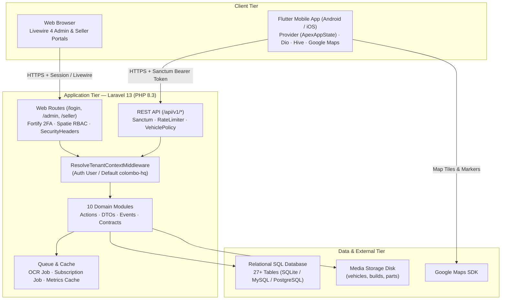
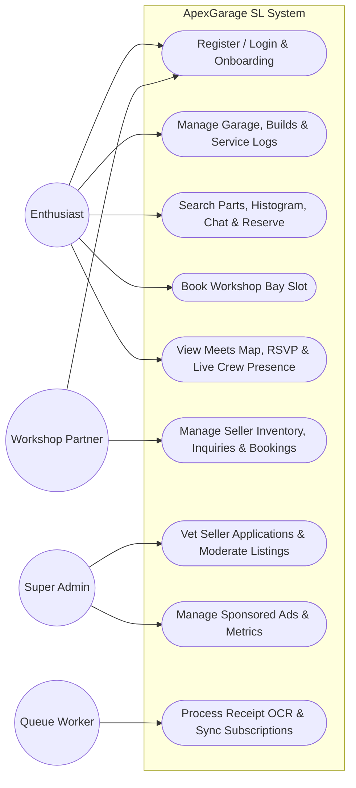
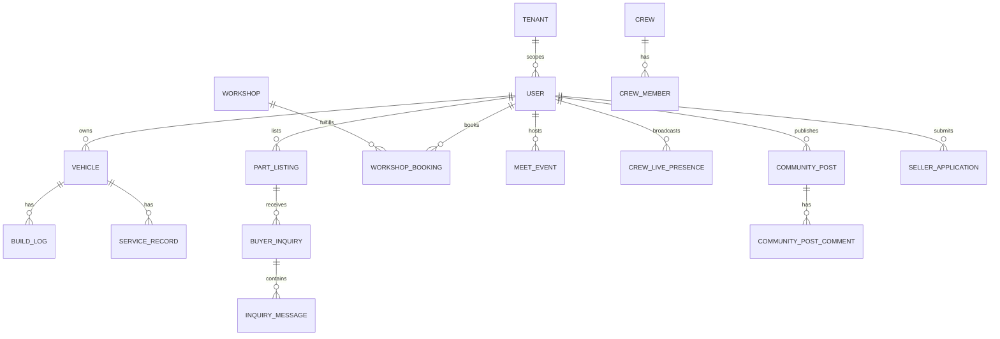
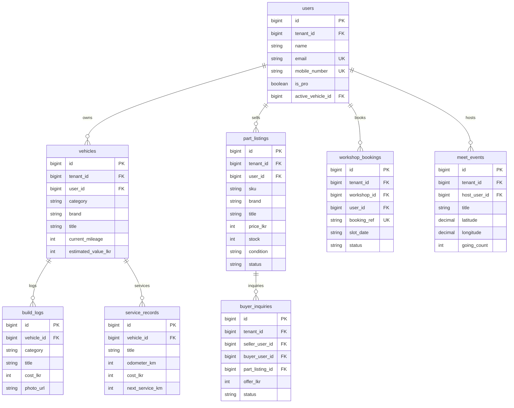
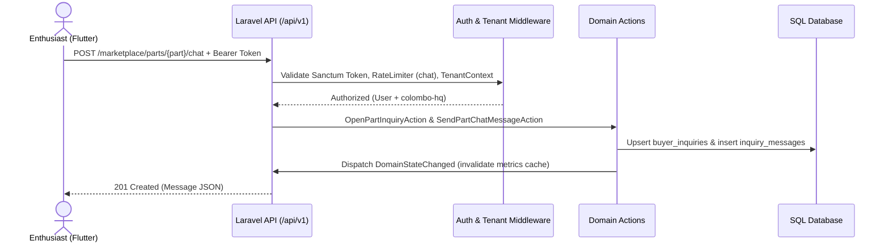
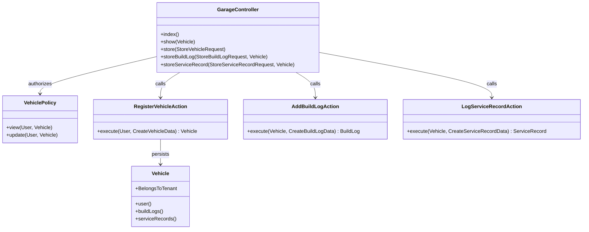
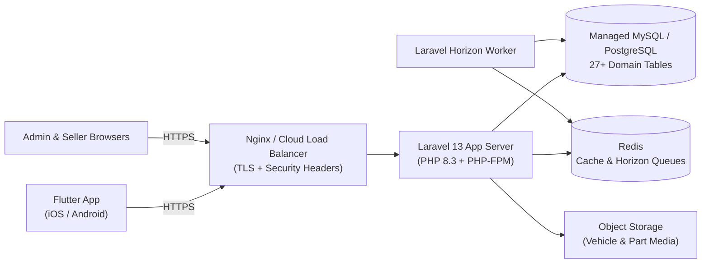

# Chapter 5: Design

This chapter presents the architectural, functional, data, behavioral, and deployment design of **ApexGarage SL**, along with hardware/software requirements and an evaluation of technology alternatives.

---

## 5.1 Proposed System

ApexGarage SL is designed as a **multi-tier, domain-driven, multi-tenant platform** serving both mobile clients and web-based management portals:

1. **Client Tier (Flutter Mobile & Browser):**
   - **Flutter Mobile App (`apexgarage_sl`):** Communicates exclusively with the Laravel REST API (`/api/v1/*`) via `Dio` and `ApiRepository`, persisting Sanctum bearer tokens locally in `Hive` (`TokenStorage`). Renders interactive meets and live crew maps via `google_maps_flutter` and captures photos via `image_picker`.
   - **Web Browser (Livewire Portals):** Accesses `/login`, `/admin`, and `/seller` over HTTPS with server-side session authentication, CSRF protection, Fortify 2FA, and strict `SecurityHeadersMiddleware`.
2. **Application & Domain Tier (Laravel 13 / PHP 8.3):**
   - Exposes versioned `/api/v1` REST endpoints and Livewire 4 reactive components.
   - Organizes business logic into 10 bounded domains (`Auth`, `Tenancy`, `Garage`, `Marketplace`, `Workshops`, `Community`, `Advertising`, `Vetting`, `Subscriptions`, `Dashboard`) using Action classes, DTOs, Policies (`VehiclePolicy`), and Service Interfaces (`DashboardMetricsServiceInterface`, `MediaStorageInterface`, `TelcoBillingGatewayInterface`).
3. **Data & Queue Tier:**
   - Relational SQL database (27+ tables scoped by `tenant_id` via `BelongsToTenant` and `TenantScope`), local/public disk media storage, cache layer for dashboard metrics (`CachedDashboardMetricsService`), and Laravel queue workers (`ProcessServiceReceiptOcrJob`, `SyncIdeaBizSubscriptionJob`).

*Figure 4: System architecture — Flutter client, Laravel API, Livewire portals, and data tier*

---

### Users and Roles

*Table 7: Stakeholders and system roles*

| Role | Who | Main Goals |
| :--- | :--- | :--- |
| **Enthusiast (User)** | Vehicle owners, riders, club members | Manage fleet, log builds & service glovebox, buy/sell parts, book mechanics, RSVP to meets, share live crew presence |
| **Workshop Partner (`workshop-partner`)** | Vetted mechanics, parts merchants | Manage part inventory, reply to buyer inquiries, accept/complete workshop bay bookings, update shop profile |
| **Super Admin (`super-admin`)** | Platform administrators | Vet and approve/reject seller applications, moderate part listings, manage sponsored ads, view platform metrics |
| **Queue Worker / Scheduler** | Laravel background workers | Process asynchronous receipt OCR (`ProcessServiceReceiptOcrJob`) and sync IdeaBiz subscriptions (`SyncIdeaBizSubscriptionJob`) |

*Figure 5: Use case diagram — Enthusiast, Workshop Partner, Super Admin, and Queue Worker*

*Table 8: Use case description — Publish Part Listing & Buyer Inquiry Chat*

| Item | Description |
| :--- | :--- |
| **Use case** | Publish Part Listing & Buyer Inquiry Chat |
| **Actors** | Enthusiast (Buyer), Workshop Partner (Seller) |
| **Precondition** | Both users are authenticated with valid Sanctum tokens within the active tenant (`colombo-hq`). |
| **Main flow** | 1. Seller uploads a part photo (`POST /api/v1/media/upload`) and publishes a listing (`POST /api/v1/marketplace/parts`). 2. Buyer searches/filters parts (`GET /api/v1/marketplace/parts` & `/histogram`), opens the listing, and sends a chat message (`POST /api/v1/marketplace/parts/{part}/chat`). 3. `OpenPartInquiryAction` creates or retrieves the `BuyerInquiry` thread and `SendPartChatMessageAction` stores the message. 4. Seller views open inquiries in Seller Mode or `/seller` portal and replies (`POST /api/v1/seller/inquiries/{inquiry}/reply`). 5. Buyer reserves the part (`POST /api/v1/marketplace/parts/{part}/reserve`). |
| **Alternative flows** | Unauthenticated request returns `401`. Non-seller calling `/seller/*` returns `403`. Rate limit exceeded (`throttle:chat`) returns `429`. |
| **Postcondition** | Inquiry message is persisted, part status/stock updates on reservation, and dashboard cache is invalidated via `DomainStateChanged`. |

---

### Functional Requirements

*Table 9: Functional requirements*

| ID | Module | Requirement | Priority |
| :--- | :--- | :--- | :--- |
| **FR-01** | Auth | Register with Sri Lankan mobile normalization (`077...` -> `+9477...`) or email, sign in, and revoke token on sign out | Must |
| **FR-02** | Auth & RBAC | Enforce role-based access (`super-admin`, `workshop-partner`, `pro-member`) across API and Livewire portals | Must |
| **FR-03** | Onboarding | Capture enthusiast automotive cultures and set active vehicle context | Should |
| **FR-04** | Home Feed | Display active vehicle summary, next meet preview, active promotion, sponsored ads, and community posts | Must |
| **FR-05** | Garage | Create, list, and view vehicles with specs, odometer, and `VehiclePolicy` owner-only access | Must |
| **FR-06** | Garage | Add modification build logs with photos and optional sharing to the community feed | Must |
| **FR-07** | Garage | Log service glovebox records with parts replaced, cost in LKR, and next service milestones | Must |
| **FR-08** | Media | Upload vehicle, build, and part images via `/api/v1/media/upload` | Must |
| **FR-09** | Marketplace | Browse, search, and filter part listings by brand, condition, and price range | Must |
| **FR-10** | Marketplace | Provide price distribution histogram data (`/marketplace/parts/histogram`) | Should |
| **FR-11** | Marketplace | Save/unsave favorite parts and reserve parts | Must |
| **FR-12** | Marketplace | Real-time-style buyer-seller inquiry chat threads per part listing | Must |
| **FR-13** | Workshops | Browse verified workshops, check available time slots, and book a service bay | Must |
| **FR-14** | Meets | View meets on an interactive Google Map, RSVP to meets, and host new meets | Must |
| **FR-15** | Crews | Create and join enthusiast crews and toggle live riding presence on the map | Should |
| **FR-16** | Community | Like and comment on community build posts | Should |
| **FR-17** | Seller Mode | Provide mobile Seller Mode & `/seller` Livewire portal for inventory, inquiries, bookings, and shop profile | Must |
| **FR-18** | Admin Vetting | Review, approve, or reject `SellerApplication` dossiers in `/admin` Livewire portal | Must |
| **FR-19** | Admin Moderation | Moderate marketplace part listings and manage sponsored ads (CTR, impressions, toggle active) | Should |
| **FR-20** | Tenancy | Isolate domain records by `tenant_id` resolved server-side | Must |
| **FR-21** | Subscriptions | Support IdeaBiz subscription activation and background sync job (backend service) | Could |
| **FR-22** | Dashboard Cache | Invalidate cached dashboard metrics automatically when domain state changes | Should |

---

### Non-Functional Requirements

*Table 10: Non-Functional requirements*

| ID | Quality | Requirement |
| :--- | :--- | :--- |
| **NFR-01** | Security | Passwords hashed with BCrypt; Sanctum bearer tokens; Fortify 2FA & passkeys on web; `VehiclePolicy` prevents IDOR |
| **NFR-02** | Security | `ResolveTenantContextMiddleware` ignores client-forged `X-Tenant-ID` headers; `SecurityHeadersMiddleware` sets CSP, HSTS, `X-Frame-Options: DENY` |
| **NFR-03** | Abuse Protection | Tiered `RateLimiter` (`auth` 5/min, `register` 5/min, `chat` 30/min, `uploads` 20/min, `meet-host` 5/hr, `api` 120/min) |
| **NFR-04** | Performance | Dashboard metrics cached via `CachedDashboardMetricsService`; `Dio` timeouts set to 10s connect / 15s read-write |
| **NFR-05** | Maintainability | Domain-driven folder structure (`app/Domains/*`), strict `FormRequest` validation, and `very_good_analysis` lint rules on Flutter |
| **NFR-06** | Portability | Cross-platform Flutter client (Android & iOS) and database-agnostic Laravel migrations (SQLite/MySQL/PostgreSQL) |
| **NFR-07** | Reliability | Seeded fallback models in Flutter `ApexAppState` and transactional DB writes on backend |
| **NFR-08** | Usability | Consistent dark-automotive UI theme, 5-tab navigation, and badge counters for pending seller inquiries/bookings |
| **NFR-09** | Localization | LKR currency formatting, Sri Lankan `+94` mobile normalization, and Colombo-centered map defaults |
| **NFR-10** | Testability | Automated Pest feature/unit suite verifying RBAC, tenancy, policies, and API contracts |

---

### Data Design

Conceptually, a **Tenant** scopes **Users**, **Vehicles**, **PartListings**, **Workshops**, **MeetEvents**, **Crews**, **CommunityPosts**, and **SponsoredAds**. Each User can own multiple Vehicles (which own BuildLogs and ServiceRecords), publish or save PartListings, participate in BuyerInquiries, book WorkshopBookings, RSVP to MeetEvents, and join Crews.

*Figure 6: Conceptual ER diagram*

*Figure 7: Logical ER diagram — core domains (27+ total tables across migrations)*

---

### Behavior and Structure

*Figure 8: Sequence diagram — authenticated marketplace inquiry chat flow*

*Figure 9: Class / domain architecture diagram — Garage domain*

*Figure 10: Deployment diagram — planned production architecture*

---

## 5.2 Hardware and Software Requirements

*Table 11: Hardware requirements*

| Use | Minimum | Used in This Project |
| :--- | :--- | :--- |
| **Development Machine** | Multi-core CPU, 8 GB RAM, 20 GB free disk | Apple Mac (`macOS`), 8+ GB RAM, SSD |
| **Mobile Test Device** | Android 8.0+ / iOS 13+ device or emulator | Android Emulator / iOS Simulator |
| **Production Server (Planned)** | 2 vCPU, 4 GB RAM, 40 GB SSD | Cloud VPS / Managed PHP hosting |

*Table 12: Software requirements*

| Category | Software & Versions |
| :--- | :--- |
| **Mobile SDK** | Flutter SDK (Dart `>=3.3.0 <4.0.0`), Android SDK / Xcode |
| **Mobile Packages** | `provider 6.1.1`, `dio 5.4.0`, `hive_flutter 1.1.0`, `google_maps_flutter 2.19.0`, `image_picker 1.1.2`, `go_router 13.0.1` |
| **Backend Runtime** | PHP `^8.3`, Composer, Laravel Framework `^13.17` |
| **Backend Packages** | `laravel/sanctum ^4.4`, `laravel/fortify ^1.42`, `livewire/livewire ^4.4`, `spatie/laravel-permission ^8.5`, `laravel/horizon ^5.51`, `predis/predis ^3.7` |
| **Database** | SQLite (local/test), MySQL 8+ or PostgreSQL 15+ (production) |
| **Testing & QA** | `pestphp/pest ^4.7`, `phpunit/phpunit ^12.5`, `larastan/larastan ^3.15`, `very_good_analysis ^5.1.0` |

---

## 5.3 Evaluation of Solutions

*Table 13: Technology alternatives considered*

| Need | Options Considered | Chosen Solution | Reason for Selection |
| :--- | :--- | :--- | :--- |
| **Mobile Framework** | React Native, Native Swift/Kotlin, Flutter | **Flutter** | Single Dart codebase for Android & iOS, strong UI fidelity, `google_maps_flutter` and `very_good_analysis` support |
| **Mobile State** | Riverpod, BLoC, Provider | **Provider (`ApexAppState`)** | Lightweight reactive `ChangeNotifier` model suited to rapid multi-tab state synchronization |
| **Backend API & Portals** | Node.js/Express, .NET 8, Laravel 13 + Livewire 4 | **Laravel 13 + Livewire 4** | Built-in Sanctum tokens, Fortify 2FA, Spatie RBAC, queues, and reactive web portals in one cohesive PHP stack |
| **API Auth** | Custom JWT, OAuth2 Passport, Laravel Sanctum | **Laravel Sanctum** | Native mobile bearer token issuance/revocation with minimal overhead |
| **Maps** | Mapbox, OpenStreetMap, Google Maps | **Google Maps (`google_maps_flutter`)** | Best road coverage and familiar landmarks in Colombo and Sri Lanka |
