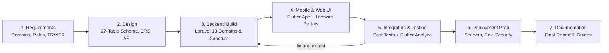
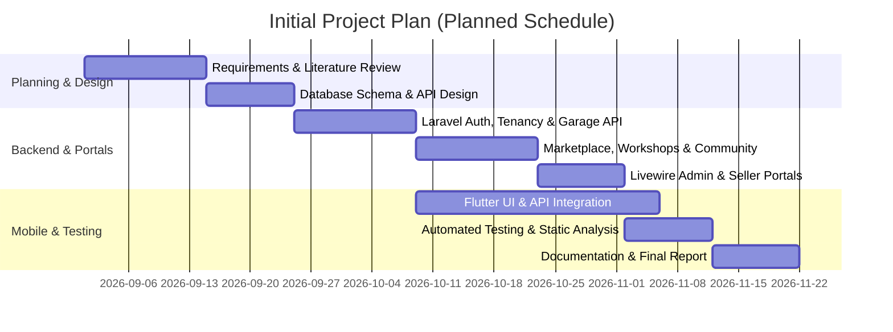
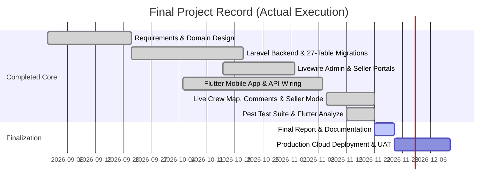
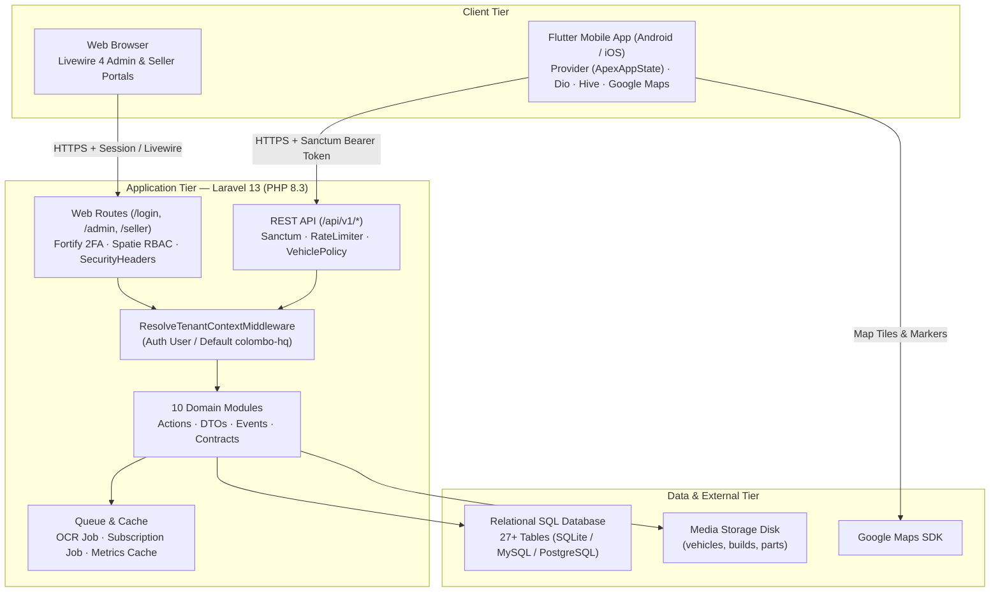
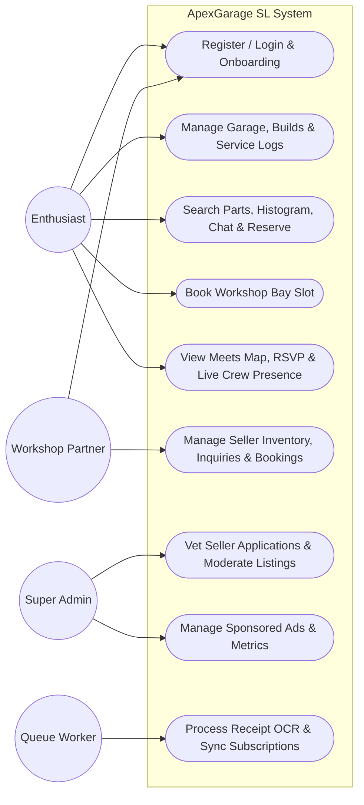
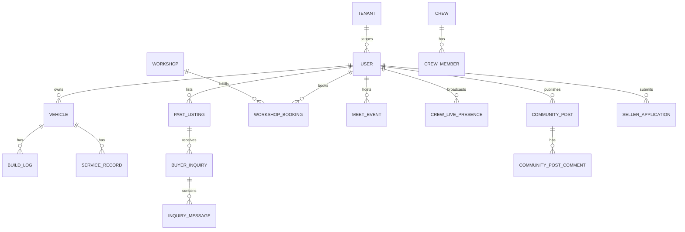
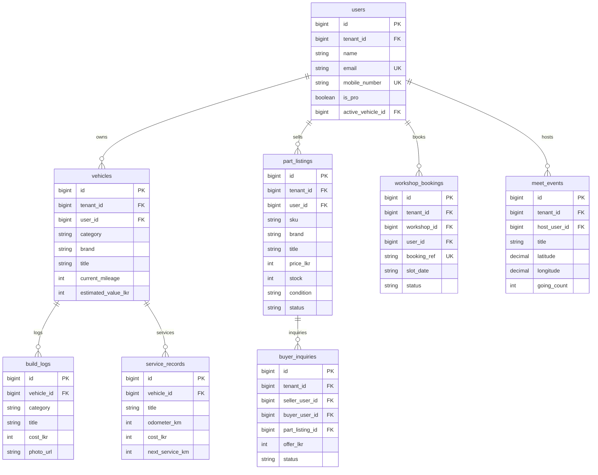
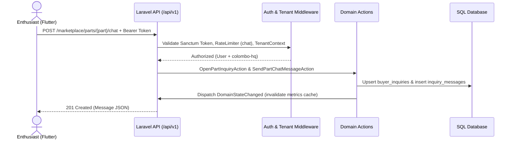
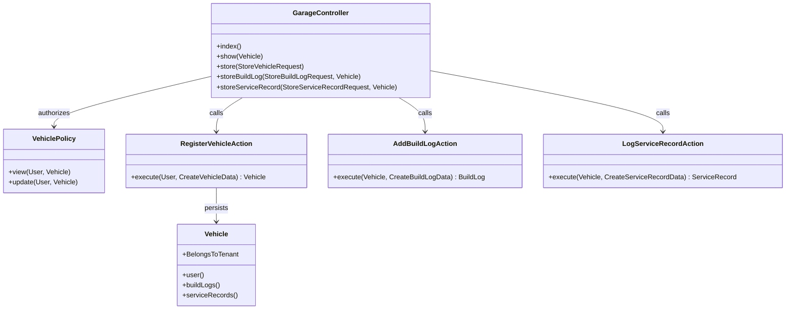
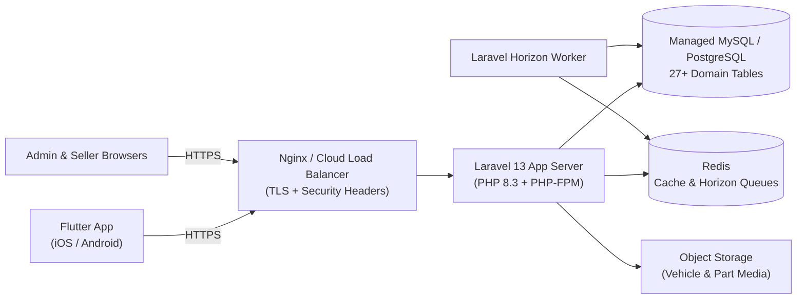

# ApexGarage SL — Digital Garage & Automotive Performance Platform

**Final Project Report**

- **Module:** CS6P05ES
- **Module Leader:** `[MODULE_LEADER]`
- **Name:** `[STUDENT_FULL_NAME]`
- **London Met ID No:** `[LONDON_MET_ID]`
- **University / Campus:** London Metropolitan University (`[CAMPUS_NAME]`)
- **Degree Programme:** `[DEGREE_PROGRAMME_TITLE]`
- **Supervisors:** `[SUPERVISOR_1_NAME]`, `[SUPERVISOR_2_NAME]`
- **Deadline / Submission Date:** `[DEADLINE_DATE]`

---

## Declaration

- **Module:** CS6P05ES &nbsp;&nbsp;&nbsp;&nbsp; **Deadline:** `[DEADLINE_DATE]`
- **Module Leader:** `[MODULE_LEADER]` &nbsp;&nbsp;&nbsp;&nbsp; **Student ID:** `[LONDON_MET_ID]`

I declare that this report and the software it describes are my own work, except where the work of others is acknowledged and referenced. I have read and understood the regulations concerning plagiarism, cheating, and collusion as set out in Section 2.3 of the University Regulations.

**Signature:** ______________________ &nbsp;&nbsp;&nbsp;&nbsp; **Date:** ______________

---

## Dedication

This project is dedicated to my parents and family, whose unwavering love, patience, and encouragement have been my greatest source of strength throughout this degree. I also dedicate this work to my friends and fellow automotive enthusiasts who inspired the vision behind ApexGarage SL and motivated me to see this project through to completion.

---

## Acknowledgements

I would like to express my sincere gratitude to my supervisors `[SUPERVISOR_1_NAME]` and `[SUPERVISOR_2_NAME]` for their guidance, constructive feedback, and patience throughout this project. I also thank the lecturers and staff at `[UNIVERSITY_AND_CAMPUS_NAME]` for their academic support, as well as the automotive enthusiasts, workshop owners, and peers who provided domain insights and tested the platform. Finally, I am deeply grateful to my family and friends for their encouragement and support.

---

## Abstract

Automotive enthusiasts, vehicle owners, and independent aftermarket workshops in Sri Lanka lack a unified digital platform to manage vehicle build histories, verify service records, source authentic performance parts, and coordinate community meets. Currently, vehicle maintenance logs are kept on paper, performance parts are traded informally across unverified social media groups, and workshop appointments rely on manual phone calls. The goal of this project was to design, implement, and verify ApexGarage SL, a secure, multi-tenant mobile and web platform that consolidates digital garage management, an automotive parts marketplace, workshop bay booking, and live community meet coordination into a single cohesive ecosystem.

The platform supports four primary user roles: Enthusiasts, Workshop Partners, Super Administrators, and Background Queue Workers. Through the cross-platform Flutter mobile application, enthusiasts can register vehicles, log modification build histories and service glovebox records with receipt uploads, browse and filter performance parts using a price distribution histogram, chat directly with verified sellers, book workshop service bays, and confirm attendance at automotive meets or share live riding locations with their crew on an interactive map. Workshop Partners and Super Administrators are supported through both a dedicated mobile Seller Mode and web-based Livewire portals for merchant vetting, inventory management, inquiry replies, booking approvals, sponsored advertisement management, and platform analytics.

The system was designed using a domain-driven, multi-tier architecture consisting of a Flutter mobile client, a Laravel REST application programming interface secured with Sanctum bearer tokens and role-based access control, Livewire administrative and seller web portals, and a relational database with twenty-seven domain tables scoped by tenant isolation. Security controls include password hashing, two-factor authentication, passkey support, strict vehicle ownership policies, tiered rate limiting, and server-side security headers.

Verification was conducted using automated Pest feature and unit tests alongside Flutter static analysis. All seventeen automated backend tests comprising two hundred and two assertions passed in six hundred and thirty milliseconds, while static analysis confirmed zero errors and zero warnings across the mobile codebase. In conclusion, the project demonstrates that a unified, localized automotive platform can successfully replace fragmented manual workflows with a secure, scalable, and verifiable digital ecosystem.

---

## Table of Contents

- [Declaration](#declaration)
- [Dedication](#dedication)
- [Acknowledgements](#acknowledgements)
- [Abstract](#abstract)
- [Table of Figures](#table-of-figures)
- [Table of Tables](#table-of-tables)
- [Abbreviations](#abbreviations)
- [Chapter 1: Introduction](01_introduction.md)
  - 1.1 Goals
  - 1.2 Motivation
  - 1.3 Method
  - 1.4 Overview
- [Chapter 2: Background and Problem Statement](02_background_and_problem_statement.md)
  - 2.1 Introduction
  - 2.2 Literature Review
  - 2.3 Problem Statement
- [Chapter 3: Project Management](03_project_management.md)
  - 3.1 Approach
  - 3.2 Initial Project Plan
  - 3.3 Problems and Changes to the Plan
  - 3.4 Final Project Record
- [Chapter 4: Feasibility Study](04_feasibility_study.md)
  - 4.1 Time Feasibility
  - 4.2 Cost Feasibility
  - 4.3 Scope Feasibility
  - 4.4 Technical Feasibility
  - 4.5 Economic Feasibility
- [Chapter 5: Design](05_design.md)
  - 5.1 Proposed System
  - 5.2 Hardware and Software Requirements
  - 5.3 Evaluation of Solutions
- [Chapter 6: Implementation](06_implementation.md)
  - 6.1 Backend Architecture & Security
  - 6.2 Mobile Frontend (Flutter) & Web Portals (Livewire)
  - 6.3 Multi-Tenancy, Caching & Background Jobs
  - 6.4 Modules
- [Chapter 7: Testing and Verification](07_testing_and_verification.md)
  - 7.1 Test Plan
  - 7.2 Automated Backend Tests & Static Analysis
  - 7.3 System Test Cases
  - 7.4 Observations and Defects Addressed
  - 7.5 Test Summary
- [Chapter 8: Evaluation and Conclusion](08_evaluation_and_conclusion.md)
  - 8.1 Evaluation Against Objectives
  - 8.2 Critical Evaluation
  - 8.3 Limitations
  - 8.4 Future Plans
  - 8.5 Conclusion
- [References & Appendices](09_references_and_appendices.md)
  - References
  - Appendix A: Interim Progress Reports
  - Appendix B: Progress Approval Form & Project Commencement Meeting Sheet
  - Appendix C: Company Letter
  - Appendix D: Running the System and Demo Accounts
  - Appendix E: Key Database Migrations Reference

---

## Table of Figures

- Figure 1: Iterative Development Methodology with Fix-and-Retest Loop (Chapter 3)
- Figure 2: Initial Project Plan — Gantt Chart (Chapter 3)
- Figure 3: Final Project Record — Gantt Chart (Chapter 3)
- Figure 4: System Architecture — Flutter Client, Laravel API, Livewire Portals & Data Tier (Chapter 5)
- Figure 5: Use Case Diagram — Enthusiast, Workshop Partner, Super Admin & Queue Worker (Chapter 5)
- Figure 6: Conceptual Entity-Relationship Diagram (Chapter 5)
- Figure 7: Logical Entity-Relationship Diagram — Core Domains (Chapter 5)
- Figure 8: Sequence Diagram — Authenticated Garage & Marketplace Flow (Chapter 5)
- Figure 9: Class / Domain Architecture Diagram — Laravel Domains & Actions (Chapter 5)
- Figure 10: Deployment Diagram — Planned Production Architecture (Chapter 5)

---

## Table of Tables

- Table 1: Comparison of Existing Automotive Platforms with ApexGarage SL (Chapter 2)
- Table 2: Tasks in the Initial Project Plan (Chapter 3)
- Table 3: Problems Encountered and Changes to the Plan (Chapter 3)
- Table 4: Progress Against Interim Milestones (Chapter 3)
- Table 5: Cost Feasibility Assessment (Chapter 4)
- Table 6: Project Scope — In Scope vs. Out of Scope (Chapter 4)
- Table 7: Stakeholders and System Roles (Chapter 5)
- Table 8: Use Case Description — Publish Part Listing & Buyer Inquiry Chat (Chapter 5)
- Table 9: Functional Requirements (FR-01 to FR-22) (Chapter 5)
- Table 10: Non-Functional Requirements (NFR-01 to NFR-10) (Chapter 5)
- Table 11: Hardware Requirements (Chapter 5)
- Table 12: Software Requirements (Chapter 5)
- Table 13: Technology Alternatives Considered (Chapter 5)
- Table 14: Backend REST API Endpoints (`/api/v1`) (Chapter 6)
- Table 15: Role and Permission Matrix (Chapter 6)
- Table 16: Flutter Mobile Screens & Seller Mode Views (Chapter 6)
- Table 17: Livewire Web Portals & Routes (Chapter 6)
- Table 18: Test Plan Overview (Chapter 7)
- Table 19: Test Strategy & Tooling (Chapter 7)
- Table 20: Automated Backend Test Suites (Pest) (Chapter 7)
- Table 21: Static Analysis Summary (`flutter analyze`) (Chapter 7)
- Table 22: System Test Cases (TC-01 to TC-28) (Chapter 7)
- Table 23: Defects Identified and Addressed (Chapter 7)
- Table 24: Evaluation Against Project Objectives (Chapter 8)
- Table 25: Future System Improvements (Chapter 8)
- Table 26: Research and Feature Extensions (Chapter 8)
- Table 27: Seeded Demo Accounts (Appendix A)

---

## Abbreviations

| Abbreviation | Full Form |
| :--- | :--- |
| **API** | Application Programming Interface |
| **BR** | Business Registration (Sri Lanka) |
| **CRUD** | Create, Read, Update, Delete |
| **CSP** | Content Security Policy |
| **CTR** | Click-Through Rate |
| **DTO** | Data Transfer Object |
| **ERD** | Entity-Relationship Diagram |
| **FK** | Foreign Key |
| **FR** | Functional Requirement |
| **GPS** | Global Positioning System |
| **HSTS** | HTTP Strict Transport Security |
| **HTTP / HTTPS** | Hypertext Transfer Protocol / Secure |
| **IDOR** | Insecure Direct Object Reference |
| **JSON** | JavaScript Object Notation |
| **LKR** | Sri Lankan Rupee |
| **MVC** | Model-View-Controller |
| **NFR** | Non-Functional Requirement |
| **OCR** | Optical Character Recognition |
| **ORM** | Object-Relational Mapping |
| **OTP** | One-Time Password |
| **PK** | Primary Key |
| **RBAC** | Role-Based Access Control |
| **REST** | Representational State Transfer |
| **RSVP** | Répondez s'il vous plaît (Event Attendance Confirmation) |
| **SDK** | Software Development Kit |
| **SKU** | Stock Keeping Unit |
| **SL** | Sri Lanka |
| **SQL** | Structured Query Language |
| **UAT** | User Acceptance Testing |
| **UI / UX** | User Interface / User Experience |
| **UML** | Unified Modeling Language |
| **2FA** | Two-Factor Authentication |

---

# Chapter 1: Introduction

This chapter presents an overview of the **ApexGarage SL** project. It outlines the project goals, the motivation behind building a localized automotive ecosystem for Sri Lanka, the iterative development methodology adopted, and the overall scope and structure of this report.

---

## 1.1 Goals

The primary goal of this project was to design, develop, and verify a secure, multi-tenant mobile and web platform tailored for Sri Lankan automotive enthusiasts, vehicle owners, and aftermarket workshops. The specific objectives were:

1. **Research the automotive ecosystem:** Study the challenges faced by Sri Lankan car and motorcycle enthusiasts, parts sellers, and independent workshops, as well as the limitations of existing fragmented platforms.
2. **Select a scalable technology stack:** Choose a cross-platform mobile framework (Flutter) paired with a domain-driven backend API and web portal stack (Laravel 13, Sanctum, Livewire 4, Spatie RBAC).
3. **Build a digital garage and service glovebox:** Enable vehicle owners to catalog their fleet, document modification build logs with photos, and maintain verifiable service records with odometer and next-service tracking.
4. **Implement a verified marketplace and workshop booking system:** Provide a parts marketplace with price-histogram filtering, direct buyer-seller chat, part reservations, and workshop bay slot booking.
5. **Deliver community meets and live crew tracking:** Build an interactive map and community feed where enthusiasts can share builds, RSVP to meets, join crews, and toggle live riding presence.
6. **Provide role-based seller and admin portals:** Implement a mobile Seller Mode and web-based Livewire portals for merchant vetting, listing moderation, inquiry management, and platform analytics, and verify the system through automated testing and static analysis.

---

## 1.2 Motivation

Sri Lanka has a vibrant automotive and motorcycle enthusiast community spanning JDM imports, European performance builds, off-road 4x4s, and sportbikes. However, the tools used by this community remain highly fragmented and informal:

- **Paper-based maintenance:** Vehicle service histories and modification receipts are typically stored as loose paper invoices, making it difficult to prove provenance or track service intervals when reselling a vehicle.
- **Unverified parts trading:** Performance and OEM spare parts are predominantly bought and sold through general classifieds or social media groups without structured fitment metadata, price distribution visibility, or verified merchant vetting.
- **Manual workshop scheduling:** Independent garages and tuning shops rely on phone calls and messaging apps to schedule service bays, leading to double-bookings and poor visibility into available time slots.
- **Disconnected community coordination:** Car meets, night runs, and crew rides are organized across separate messaging chats with no centralized map, RSVP tracking, or live crew presence.

By consolidating these workflows into **ApexGarage SL**, enthusiasts gain a single digital home for their vehicles, while local workshops and parts merchants gain a vetted, structured channel to reach customers and manage bookings.

---

## 1.3 Method

The project followed an **iterative, phase-based development methodology** with a continuous fix-and-retest loop. Work was structured into seven core phases:

1. **Requirements & Domain Research:** Identifying user roles, functional/non-functional requirements, and Sri Lankan localization needs (LKR currency, `+94` mobile normalization, Colombo-centered mapping).
2. **Architecture & Database Design:** Designing the domain-driven Laravel backend, 27-table relational schema, multi-tenancy isolation, and Flutter state architecture.
3. **Backend API & Portal Implementation:** Building Laravel 13 domain actions, Sanctum REST endpoints (`/api/v1`), `VehiclePolicy` authorization, and Livewire 4 web portals (`/admin`, `/seller`).
4. **Flutter Mobile App Implementation:** Developing the enthusiast 5-tab shell, Seller Mode shell, Google Maps integration, image upload flows, and Hive-backed token persistence.
5. **Integration & Feature Wiring:** Connecting all Flutter screens to live Laravel endpoints via `ApiRepository` and `Dio`, including fallback seed models for offline preview.
6. **Testing & Static Analysis:** Writing and running automated Pest feature/unit tests (`php artisan test`) and Flutter static analysis (`flutter analyze`), fixing defects iteratively.
7. **Deployment Preparation & Documentation:** Preparing environment configurations, database seeders, and compiling this final project report.

---

## 1.4 Overview

**ApexGarage SL** operates in the domain of automotive lifestyle, e-commerce, and workshop management software. It comprises:

- **Mobile Client:** A Flutter application (`apexgarage_sl`) supporting iOS and Android, using `Provider` (`ApexAppState`), `Dio` with `AuthInterceptor`, `Hive` for local session persistence, `google_maps_flutter` for meet and crew mapping, and `image_picker` for vehicle, build, and part photography.
- **Backend API & Web Portals:** A Laravel 13 PHP 8.3 application organized into 10 domain modules (`Auth`, `Tenancy`, `Garage`, `Marketplace`, `Workshops`, `Community`, `Advertising`, `Vetting`, `Subscriptions`, `Dashboard`), exposing `/api/v1/*` REST endpoints via Laravel Sanctum and `/admin` and `/seller` web portals via Livewire 4.
- **Data Layer:** A relational SQL database (SQLite in local development/testing, compatible with PostgreSQL/MySQL in production) managed via Laravel migrations and Eloquent ORM.

**Scope.** The current implementation covers full end-to-end flows for Enthusiasts, Workshop Partners/Sellers, and Super Administrators in Sri Lanka (LKR pricing, `+94` phone validation, Colombo-centered map coordinates). Live carrier billing via Dialog IdeaBiz and automated OCR receipt extraction are architected via service interfaces (`TelcoBillingGatewayInterface`, `ProcessServiceReceiptOcrJob`) and simulated/queued for future production activation.

The remainder of this report is organized as follows: **Chapter 2** reviews the background, literature, and problem statement. **Chapter 3** details project management, plans, and changes. **Chapter 4** presents the feasibility study. **Chapter 5** covers system design, diagrams, and requirements. **Chapter 6** explains the implementation of backend, mobile, and web modules. **Chapter 7** presents the test plan, automated test results, and defects addressed. **Chapter 8** evaluates the project against its objectives, discusses limitations and future work, and concludes.

---

# Chapter 2: Background and Problem Statement

This chapter examines the automotive aftermarket and enthusiast domain, reviews relevant literature and existing software platforms, identifies the research and market gap, and defines the problem statement addressed by ApexGarage SL.

---

## 2.1 Introduction

Digitalization in the automotive sector has traditionally focused on new-vehicle telematics, manufacturer-authorized service centers, and generic classifieds websites. In emerging markets such as Sri Lanka, however, the secondary vehicle market and aftermarket modification culture represent a large share of automotive spending. Vehicles are owned longer, modified across multiple specialist workshops, and traded peer-to-peer. When maintenance records, part provenance, and workshop reputations are undocumented, both buyers and sellers face high information asymmetry.

At the same time, automotive enthusiasm is inherently social. Car and motorcycle clubs rely on shared visual build logs, trusted mechanic recommendations, and coordinated group drives. A platform that unifies **vehicle lifecycle records**, **vetted commerce**, **service scheduling**, and **community engagement** addresses both practical ownership pain points and social engagement.

---

## 2.2 Literature Review

### 2.2.1 Digital Vehicle Maintenance & Provenance Systems
Maintaining accurate, tamper-resistant vehicle service histories reduces information asymmetry in used-vehicle markets (Akerlof, 1970). Digital glovebox applications allow owners to log odometer readings, parts replaced, and workshop invoices chronologically. When linked to specific vehicle chassis/VIN identifiers and verified workshops, digital logs increase buyer confidence and resale value compared to paper receipts.

### 2.2.2 Vertical Marketplaces vs. Horizontal Classifieds
Horizontal classified platforms (such as general-purpose buy-and-sell sites) optimize for broad listing volume rather than domain-specific trust. In contrast, vertical automotive marketplaces improve buyer conversion by enforcing structured fitment metadata (chassis code, condition, SKU), price-distribution visibility (histograms), and seller verification (vetting business registration details before granting merchant status). Direct in-app inquiry threads further reduce friction compared to redirecting users to external messaging apps.

### 2.2.3 Multi-Tenant SaaS & Domain-Driven Architecture
Modern SaaS platforms serving multiple regional hubs or partner networks benefit from multi-tenancy with strict data isolation (Fowler, 2002). Implementing a shared-database, tenant-scoped architecture using global query scopes (`TenantScope`) and server-side tenant resolution ensures that client requests cannot spoof tenant boundaries via forged HTTP headers. Organizing backend logic into bounded domain modules (`Garage`, `Marketplace`, `Workshops`, `Community`, `Vetting`) using single-responsibility Action classes and DTOs improves maintainability and testability (Evans, 2003).

### 2.2.4 Role-Based Access Control (RBAC) & Mobile API Security
Mobile applications communicating over REST APIs require stateless bearer-token authentication (such as Laravel Sanctum), strict object-level authorization policies to prevent Insecure Direct Object References (IDOR), and tiered rate limiting to mitigate brute-force and credential-stuffing attacks (OWASP, 2023). Separating public discovery endpoints from authenticated write endpoints and restricting administrative actions via explicit RBAC permissions (`spatie/laravel-permission`) enforces least-privilege access.

### 2.2.5 Community Mapping & Real-Time Presence
Location-based community features—such as interactive meet maps and live crew riding indicators—strengthen user retention in niche hobbyist networks. Using standard coordinate mapping (`google_maps_flutter`) paired with lightweight opt-in presence records (`crew_live_presences` with last-seen timestamps) allows riders and drivers to coordinate group runs without requiring continuous high-bandwidth GPS streaming.

### 2.2.6 Comparison with Existing Systems

Table 1 compares existing platform categories available to Sri Lankan automotive users against ApexGarage SL.

*Table 1: Comparison of existing system types with ApexGarage SL*

| System Type | Digital Garage & Build Logs | Verified Parts Marketplace | Workshop Bay Booking | Community Meets & Live Crew Map | Local SL Context (LKR / +94) |
| :--- | :--- | :--- | :--- | :--- | :--- |
| **General Classifieds** (e.g., ikman.lk) | No | Partial (unstructured) | No | No | Yes |
| **Social Media Groups** (Facebook / WhatsApp) | Informal posts only | Unverified, no escrow/chat tracking | No | Informal chat messages | Yes |
| **Global Garage Apps** (e.g., Fuelly, Carfax) | Basic maintenance only | No | No | No | No (USD/US focus) |
| **Standalone Booking Tools** | No | No | Yes | No | Rarely |
| **ApexGarage SL** | **Yes (Builds + Service Glovebox)** | **Yes (Vetted sellers, histogram, chat, reserve)** | **Yes (Slot availability & booking)** | **Yes (Meets map, RSVPs, Crews, Live presence)** | **Yes (LKR, +94, Colombo map)** |

### 2.2.7 Research Gap
Existing tools solve at most one fragment of the automotive ownership lifecycle: classifieds handle ad-hoc listings without fitment or vetting; social media hosts informal discussions without structured history; and global maintenance trackers lack local Sri Lankan parts commerce, workshop scheduling, and community meet coordination. Very few platforms integrate **multi-role workflows** (Enthusiast, Workshop Partner, Super Admin) with **tenant-isolated domain APIs** and **localized Sri Lankan conventions** in a single mobile-first ecosystem.

---

## 2.3 Problem Statement

The key problems addressed by this project are:

- **Fragmented Vehicle Records:** Sri Lankan vehicle owners lack a centralized digital system to track modification builds, odometer milestones, and verified service histories.
- **Low Trust in Aftermarket Parts Trading:** Buyers cannot easily verify seller legitimacy, compare part pricing distributions, or track inquiries and reservations in one place.
- **Inefficient Workshop Scheduling:** Independent garages lack an integrated digital bay-booking and status-management workflow connected directly to customer vehicles.
- **Scattered Community Coordination:** Enthusiast meets, club memberships, and group rides lack a dedicated map-based coordination tool.
- **Lack of Unified Merchant & Admin Governance:** Platform operators need a vetting workflow to approve workshop partners, moderate listings, and monitor platform-wide metrics securely.

**ApexGarage SL** solves these problems by delivering a unified Flutter mobile application and Laravel 13 backend with role-based web portals, combining garage management, vetted marketplace commerce, workshop booking, and live community mapping under a secure, multi-tenant architecture.

---

# Chapter 3: Project Management

This chapter describes the project management approach, the initial project plan, the challenges encountered that led to plan adjustments, and the final project record.

---

## 3.1 Approach

An **iterative, phase-based development approach** with a fix-and-retest loop was adopted. Because ApexGarage SL spans two distinct codebases—a cross-platform Flutter mobile client and a Laravel 13 backend with Livewire web portals—building in vertical increments allowed each domain (`Auth`, `Garage`, `Marketplace`, `Workshops`, `Community`, `Seller/Admin`) to be implemented end-to-end and verified with automated tests before moving to the next phase.



*Figure 1: Development methodology — phases with a fix-and-re-test loop*

---

## 3.2 Initial Project Plan

The initial plan structured the work across `[PROJECT_DURATION_WEEKS]` weeks from project proposal through final report submission, prioritizing backend domain modeling and authentication before mobile feature wiring and testing.



*Figure 2: Initial project plan (Gantt chart, planned dates — adjust `[YYYY-MM-DD]` placeholders to match your official schedule)*

*Table 2: Tasks in the initial plan*

| Task | Planned Window | Description |
| :--- | :--- | :--- |
| Requirements & Literature Review | `[PHASE_1_DATES]` | Domain study, stakeholder roles, FR/NFR specification |
| Database Schema & API Design | `[PHASE_2_DATES]` | 27-table relational schema, ERD, `/api/v1` contract |
| Backend Core (Auth, Tenancy, Garage) | `[PHASE_3_DATES]` | Sanctum auth, Spatie RBAC, `TenantScope`, `VehiclePolicy` |
| Backend Commerce & Community | `[PHASE_4_DATES]` | Marketplace, workshops, meets, crews, feed, promotions |
| Livewire Admin & Seller Portals | `[PHASE_5_DATES]` | Web `/admin` vetting/moderation and `/seller` dashboard |
| Flutter Mobile App & Integration | `[PHASE_6_DATES]` | 5-tab Enthusiast shell, Seller Mode, Google Maps, Dio client |
| Automated Testing & Static Analysis | `[PHASE_7_DATES]` | Pest feature/unit tests, `flutter analyze`, bug fixes |
| Final Report & Documentation | `[PHASE_8_DATES]` | Compile full project report, diagrams, and setup guide |

---

## 3.3 Problems and Changes to the Plan

During development and integration, several technical and practical issues required adjustments to the original plan. These are documented in Table 3.

*Table 3: Problems and changes to the plan*

| Original Plan or Problem | Change Implemented | Justification |
| :--- | :--- | :--- |
| Starter template used `GoRouter` (`AppRouter`) for basic screens | `MainShell` + `ApexAppState` stage/tab state machine drives active app navigation | Provided cleaner separation between `splash`, `auth`, `onboarding`, `SellerShell`, and the 5-tab enthusiast shell |
| Live Dialog IdeaBiz carrier billing integration planned in mobile UI | Backend `IdeaBizBillingGateway` & `SyncIdeaBizSubscriptionJob` built; mobile `POST /subscriptions/ideabiz` kept as legacy/excluded from active mobile wiring | Carrier API credentials and sandbox approval were outside local development scope; UI flow preserved for future activation |
| Physical receipt OCR processing on mobile | Offloaded to queued backend job (`ProcessServiceReceiptOcrJob`) | Keeps mobile client lightweight and allows asynchronous extraction |
| Simple flat feed and static meet pins | Added `community_post_comments`, `sponsored_ads` on `/home`, `latitude`/`longitude` on `meet_events`, and `crew_live_presences` | Required for real interactive community engagement and Google Maps crew tracking |
| Seller workflows initially planned for Web Portal only | Added full mobile `SellerShell` (5 tabs) backed by `/api/v1/seller/*` endpoints | Enables workshop partners and parts sellers to manage inventory, inquiries, and bookings directly from mobile |
| Tenant ID initially considered via request header | `ResolveTenantContextMiddleware` resolves tenant strictly from authenticated user or default `colombo-hq` | Prevents tenant-spoofing vulnerabilities (`X-Tenant-ID` header injection) |

---

## 3.4 Final Project Record

All core backend domains, Livewire web portals, Flutter mobile modules, and automated backend tests were completed. Figure 3 and Table 4 summarize the final project record against interim milestones.



*Figure 3: Final project record (Gantt chart, actual dates)*

*Table 4: Progress against the interim plan*

| Interim Milestone | Final Outcome |
| :--- | :--- |
| Backend API & Database | **Done:** Laravel 13 with 10 domains, 27+ tables, Sanctum auth, Spatie RBAC, rate limiters |
| Web Portals | **Done:** Livewire 4 `LoginGate`, `AdminPortal`, and `SellerPortal` with security headers |
| Flutter Mobile Client | **Done:** 5-tab Enthusiast shell, 5-tab Seller Mode, Google Maps meets/crews, `image_picker` uploads |
| Automated Testing | **Done:** 17 Pest tests (202 assertions) passing; `flutter analyze` 0 errors, 0 warnings |
| Extended Features (Post-Interim) | **Done:** `crew_live_presences`, meet coordinates, feed comments, dynamic `sponsored_ads`, mobile Seller API |
| Cloud Deployment & UAT | **Pending (Next Step):** Local/staging environments verified; production deployment and external UAT scheduled next |

---

# Chapter 4: Feasibility Study

A feasibility study evaluates whether the proposed project can be successfully delivered within the available time, budget, scope, technical capability, and economic constraints.

---

## 4.1 Time Feasibility

The project was structured over `[PROJECT_DURATION_WEEKS]` weeks with clear vertical milestones. High-risk architectural components—multi-tenancy isolation, Sanctum token authentication, `VehiclePolicy` authorization, and the 27-table relational schema—were completed early, allowing subsequent weeks to focus on Flutter UI integration, Seller Mode, and automated Pest test coverage. Because core development and automated verification finished within the planned window, the project proved **feasible in time**, with only live cloud deployment and formal external UAT deferred to post-submission.

---

## 4.2 Cost Feasibility

All development tools, frameworks, and local testing infrastructure used in ApexGarage SL rely on open-source software or free developer tiers, resulting in zero mandatory software licensing costs during development.

*Table 5: Cost assessment*

| Item | Option Used | Cost |
| :--- | :--- | :--- |
| Development IDEs & SDKs | Visual Studio Code, Android Studio / Xcode, Flutter SDK, PHP 8.3, Composer | Free (Open Source) |
| Backend Framework & Packages | Laravel 13, Sanctum, Fortify, Livewire 4, Spatie Permission, Pest | Free (MIT / Open Source) |
| Mobile Packages | `provider`, `dio`, `hive`, `go_router`, `image_picker`, `lucide_icons_flutter` | Free (Open Source) |
| Database (Dev & Test) | SQLite (`backend/database/database.sqlite`) | Free |
| Mapping Services | `google_maps_flutter` (Google Maps SDK free monthly credit tier) | Free within developer quota |
| Version Control & CI | Git / GitHub | Free |
| Hosting (Planned Production) | Cloud VPS / Laravel Forge + Managed MySQL/PostgreSQL + S3-compatible storage | Low monthly cost (pay-as-you-grow) |

Because every core tool is open-source and external services operate within free developer tiers during build and testing, the project is **cost-feasible**.

---

## 4.3 Scope Feasibility

The scope was carefully bounded so that a single developer could deliver a complete, verified end-to-end platform while leaving non-essential external integrations for future phases.

*Table 6: Project scope*

| In Scope | Out of Scope (Future Work) |
| :--- | :--- |
| Cross-platform Flutter app (Android & iOS) for Enthusiasts and Sellers | Native desktop or web-compiled Flutter builds |
| Digital Garage (vehicles, build logs, service glovebox, photo uploads) | OBD-II / hardware telematics dongle integration |
| Parts Marketplace (search, price histogram, save, reserve, buyer-seller chat) | Online credit/debit card payment gateway & escrow settlement |
| Workshop directory, slot availability, and bay booking | Automated workshop POS / accounting ERP |
| Interactive Colombo-centered meets map, RSVPs, crews, and live riding presence | Turn-by-turn voice navigation |
| Livewire Admin & Seller web portals (vetting, moderation, ads, metrics) | Live Dialog IdeaBiz carrier billing production credentials |
| Multi-tenancy (`colombo-hq` default) and Spatie RBAC | Automated multi-region billing & tax invoicing |

---

## 4.4 Technical Feasibility

The selected technology stack—**Flutter (Dart 3.3+)** for mobile and **Laravel 13 (PHP 8.3)** with **Livewire 4** for backend and web portals—is mature, well-documented, and supported by strong static analysis (`very_good_analysis`) and testing tools (`Pest`). Key technical risks were mitigated as follows:

- **API Security & Authorization:** Handled natively via Laravel Sanctum, `VehiclePolicy`, `ResolveTenantContextMiddleware`, `SecurityHeadersMiddleware`, and tiered `RateLimiter` rules.
- **Offline/Demo Resilience:** `ApexAppState` includes seed models (`kSeedVehicles`, `kSeedParts`, `kSeedMechanics`, `kSeedMeets`, `kSeedCrews`) so UI flows remain demonstrable even when the local API server is unreachable.
- **Mapping & Media:** `google_maps_flutter` and `image_picker` paired with `/api/v1/media/upload` (`MediaStorageInterface`) provide standard, reliable hardware and map integrations.

The project is therefore **technically feasible**.

---

## 4.5 Economic Feasibility

ApexGarage SL delivers clear economic value to all three user groups at minimal operating cost:

- **For Vehicle Owners:** Documented build logs and verified service histories protect vehicle resale value and reduce unexpected maintenance costs by tracking service intervals.
- **For Parts Sellers & Workshops:** Verified merchant status, structured fitment listings, and bay slot scheduling increase customer trust, reduce no-shows, and lower customer acquisition costs compared to scattered social media posts.
- **For Platform Operators:** Revenue pathways are built directly into the architecture through `sponsored_ads` (tracking impressions, clicks, CTR, and LKR revenue) and `subscriptions` (Pro membership tiers).

The low infrastructure footprint combined with clear monetization and user-value drivers makes the platform **economically feasible**.

---

# Chapter 5: Design

This chapter presents the architectural, functional, data, behavioral, and deployment design of **ApexGarage SL**, along with hardware/software requirements and an evaluation of technology alternatives.

---

## 5.1 Proposed System

ApexGarage SL is designed as a **multi-tier, domain-driven, multi-tenant platform** serving both mobile clients and web-based management portals:

1. **Client Tier (Flutter Mobile & Browser):**
   - **Flutter Mobile App (`apexgarage_sl`):** Communicates exclusively with the Laravel REST API (`/api/v1/*`) via `Dio` and `ApiRepository`, persisting Sanctum bearer tokens locally in `Hive` (`TokenStorage`). Renders interactive meets and live crew maps via `google_maps_flutter` and captures photos via `image_picker`.
   - **Web Browser (Livewire Portals):** Accesses `/login`, `/admin`, and `/seller` over HTTPS with server-side session authentication, CSRF protection, Fortify 2FA, and strict `SecurityHeadersMiddleware`.
2. **Application & Domain Tier (Laravel 13 / PHP 8.3):**
   - Exposes versioned `/api/v1` REST endpoints and Livewire 4 reactive components.
   - Organizes business logic into 10 bounded domains (`Auth`, `Tenancy`, `Garage`, `Marketplace`, `Workshops`, `Community`, `Advertising`, `Vetting`, `Subscriptions`, `Dashboard`) using Action classes, DTOs, Policies (`VehiclePolicy`), and Service Interfaces (`DashboardMetricsServiceInterface`, `MediaStorageInterface`, `TelcoBillingGatewayInterface`).
3. **Data & Queue Tier:**
   - Relational SQL database (27+ tables scoped by `tenant_id` via `BelongsToTenant` and `TenantScope`), local/public disk media storage, cache layer for dashboard metrics (`CachedDashboardMetricsService`), and Laravel queue workers (`ProcessServiceReceiptOcrJob`, `SyncIdeaBizSubscriptionJob`).



*Figure 4: System architecture — Flutter client, Laravel API, Livewire portals, and data tier*

---

### Users and Roles

*Table 7: Stakeholders and system roles*

| Role | Who | Main Goals |
| :--- | :--- | :--- |
| **Enthusiast (User)** | Vehicle owners, riders, club members | Manage fleet, log builds & service glovebox, buy/sell parts, book mechanics, RSVP to meets, share live crew presence |
| **Workshop Partner (`workshop-partner`)** | Vetted mechanics, parts merchants | Manage part inventory, reply to buyer inquiries, accept/complete workshop bay bookings, update shop profile |
| **Super Admin (`super-admin`)** | Platform administrators | Vet and approve/reject seller applications, moderate part listings, manage sponsored ads, view platform metrics |
| **Queue Worker / Scheduler** | Laravel background workers | Process asynchronous receipt OCR (`ProcessServiceReceiptOcrJob`) and sync IdeaBiz subscriptions (`SyncIdeaBizSubscriptionJob`) |



*Figure 5: Use case diagram — Enthusiast, Workshop Partner, Super Admin, and Queue Worker*

*Table 8: Use case description — Publish Part Listing & Buyer Inquiry Chat*

| Item | Description |
| :--- | :--- |
| **Use case** | Publish Part Listing & Buyer Inquiry Chat |
| **Actors** | Enthusiast (Buyer), Workshop Partner (Seller) |
| **Precondition** | Both users are authenticated with valid Sanctum tokens within the active tenant (`colombo-hq`). |
| **Main flow** | 1. Seller uploads a part photo (`POST /api/v1/media/upload`) and publishes a listing (`POST /api/v1/marketplace/parts`). 2. Buyer searches/filters parts (`GET /api/v1/marketplace/parts` & `/histogram`), opens the listing, and sends a chat message (`POST /api/v1/marketplace/parts/{part}/chat`). 3. `OpenPartInquiryAction` creates or retrieves the `BuyerInquiry` thread and `SendPartChatMessageAction` stores the message. 4. Seller views open inquiries in Seller Mode or `/seller` portal and replies (`POST /api/v1/seller/inquiries/{inquiry}/reply`). 5. Buyer reserves the part (`POST /api/v1/marketplace/parts/{part}/reserve`). |
| **Alternative flows** | Unauthenticated request returns `401`. Non-seller calling `/seller/*` returns `403`. Rate limit exceeded (`throttle:chat`) returns `429`. |
| **Postcondition** | Inquiry message is persisted, part status/stock updates on reservation, and dashboard cache is invalidated via `DomainStateChanged`. |

---

### Functional Requirements

*Table 9: Functional requirements*

| ID | Module | Requirement | Priority |
| :--- | :--- | :--- | :--- |
| **FR-01** | Auth | Register with Sri Lankan mobile normalization (`077...` -> `+9477...`) or email, sign in, and revoke token on sign out | Must |
| **FR-02** | Auth & RBAC | Enforce role-based access (`super-admin`, `workshop-partner`, `pro-member`) across API and Livewire portals | Must |
| **FR-03** | Onboarding | Capture enthusiast automotive cultures and set active vehicle context | Should |
| **FR-04** | Home Feed | Display active vehicle summary, next meet preview, active promotion, sponsored ads, and community posts | Must |
| **FR-05** | Garage | Create, list, and view vehicles with specs, odometer, and `VehiclePolicy` owner-only access | Must |
| **FR-06** | Garage | Add modification build logs with photos and optional sharing to the community feed | Must |
| **FR-07** | Garage | Log service glovebox records with parts replaced, cost in LKR, and next service milestones | Must |
| **FR-08** | Media | Upload vehicle, build, and part images via `/api/v1/media/upload` | Must |
| **FR-09** | Marketplace | Browse, search, and filter part listings by brand, condition, and price range | Must |
| **FR-10** | Marketplace | Provide price distribution histogram data (`/marketplace/parts/histogram`) | Should |
| **FR-11** | Marketplace | Save/unsave favorite parts and reserve parts | Must |
| **FR-12** | Marketplace | Real-time-style buyer-seller inquiry chat threads per part listing | Must |
| **FR-13** | Workshops | Browse verified workshops, check available time slots, and book a service bay | Must |
| **FR-14** | Meets | View meets on an interactive Google Map, RSVP to meets, and host new meets | Must |
| **FR-15** | Crews | Create and join enthusiast crews and toggle live riding presence on the map | Should |
| **FR-16** | Community | Like and comment on community build posts | Should |
| **FR-17** | Seller Mode | Provide mobile Seller Mode & `/seller` Livewire portal for inventory, inquiries, bookings, and shop profile | Must |
| **FR-18** | Admin Vetting | Review, approve, or reject `SellerApplication` dossiers in `/admin` Livewire portal | Must |
| **FR-19** | Admin Moderation | Moderate marketplace part listings and manage sponsored ads (CTR, impressions, toggle active) | Should |
| **FR-20** | Tenancy | Isolate domain records by `tenant_id` resolved server-side | Must |
| **FR-21** | Subscriptions | Support IdeaBiz subscription activation and background sync job (backend service) | Could |
| **FR-22** | Dashboard Cache | Invalidate cached dashboard metrics automatically when domain state changes | Should |

---

### Non-Functional Requirements

*Table 10: Non-Functional requirements*

| ID | Quality | Requirement |
| :--- | :--- | :--- |
| **NFR-01** | Security | Passwords hashed with BCrypt; Sanctum bearer tokens; Fortify 2FA & passkeys on web; `VehiclePolicy` prevents IDOR |
| **NFR-02** | Security | `ResolveTenantContextMiddleware` ignores client-forged `X-Tenant-ID` headers; `SecurityHeadersMiddleware` sets CSP, HSTS, `X-Frame-Options: DENY` |
| **NFR-03** | Abuse Protection | Tiered `RateLimiter` (`auth` 5/min, `register` 5/min, `chat` 30/min, `uploads` 20/min, `meet-host` 5/hr, `api` 120/min) |
| **NFR-04** | Performance | Dashboard metrics cached via `CachedDashboardMetricsService`; `Dio` timeouts set to 10s connect / 15s read-write |
| **NFR-05** | Maintainability | Domain-driven folder structure (`app/Domains/*`), strict `FormRequest` validation, and `very_good_analysis` lint rules on Flutter |
| **NFR-06** | Portability | Cross-platform Flutter client (Android & iOS) and database-agnostic Laravel migrations (SQLite/MySQL/PostgreSQL) |
| **NFR-07** | Reliability | Seeded fallback models in Flutter `ApexAppState` and transactional DB writes on backend |
| **NFR-08** | Usability | Consistent dark-automotive UI theme, 5-tab navigation, and badge counters for pending seller inquiries/bookings |
| **NFR-09** | Localization | LKR currency formatting, Sri Lankan `+94` mobile normalization, and Colombo-centered map defaults |
| **NFR-10** | Testability | Automated Pest feature/unit suite verifying RBAC, tenancy, policies, and API contracts |

---

### Data Design

Conceptually, a **Tenant** scopes **Users**, **Vehicles**, **PartListings**, **Workshops**, **MeetEvents**, **Crews**, **CommunityPosts**, and **SponsoredAds**. Each User can own multiple Vehicles (which own BuildLogs and ServiceRecords), publish or save PartListings, participate in BuyerInquiries, book WorkshopBookings, RSVP to MeetEvents, and join Crews.



*Figure 6: Conceptual ER diagram*



*Figure 7: Logical ER diagram — core domains (27+ total tables across migrations)*

---

### Behavior and Structure



*Figure 8: Sequence diagram — authenticated marketplace inquiry chat flow*



*Figure 9: Class / domain architecture diagram — Garage domain*



*Figure 10: Deployment diagram — planned production architecture*

---

## 5.2 Hardware and Software Requirements

*Table 11: Hardware requirements*

| Use | Minimum | Used in This Project |
| :--- | :--- | :--- |
| **Development Machine** | Multi-core CPU, 8 GB RAM, 20 GB free disk | Apple Mac (`macOS`), 8+ GB RAM, SSD |
| **Mobile Test Device** | Android 8.0+ / iOS 13+ device or emulator | Android Emulator / iOS Simulator |
| **Production Server (Planned)** | 2 vCPU, 4 GB RAM, 40 GB SSD | Cloud VPS / Managed PHP hosting |

*Table 12: Software requirements*

| Category | Software & Versions |
| :--- | :--- |
| **Mobile SDK** | Flutter SDK (Dart `>=3.3.0 <4.0.0`), Android SDK / Xcode |
| **Mobile Packages** | `provider 6.1.1`, `dio 5.4.0`, `hive_flutter 1.1.0`, `google_maps_flutter 2.19.0`, `image_picker 1.1.2`, `go_router 13.0.1` |
| **Backend Runtime** | PHP `^8.3`, Composer, Laravel Framework `^13.17` |
| **Backend Packages** | `laravel/sanctum ^4.4`, `laravel/fortify ^1.42`, `livewire/livewire ^4.4`, `spatie/laravel-permission ^8.5`, `laravel/horizon ^5.51`, `predis/predis ^3.7` |
| **Database** | SQLite (local/test), MySQL 8+ or PostgreSQL 15+ (production) |
| **Testing & QA** | `pestphp/pest ^4.7`, `phpunit/phpunit ^12.5`, `larastan/larastan ^3.15`, `very_good_analysis ^5.1.0` |

---

## 5.3 Evaluation of Solutions

*Table 13: Technology alternatives considered*

| Need | Options Considered | Chosen Solution | Reason for Selection |
| :--- | :--- | :--- | :--- |
| **Mobile Framework** | React Native, Native Swift/Kotlin, Flutter | **Flutter** | Single Dart codebase for Android & iOS, strong UI fidelity, `google_maps_flutter` and `very_good_analysis` support |
| **Mobile State** | Riverpod, BLoC, Provider | **Provider (`ApexAppState`)** | Lightweight reactive `ChangeNotifier` model suited to rapid multi-tab state synchronization |
| **Backend API & Portals** | Node.js/Express, .NET 8, Laravel 13 + Livewire 4 | **Laravel 13 + Livewire 4** | Built-in Sanctum tokens, Fortify 2FA, Spatie RBAC, queues, and reactive web portals in one cohesive PHP stack |
| **API Auth** | Custom JWT, OAuth2 Passport, Laravel Sanctum | **Laravel Sanctum** | Native mobile bearer token issuance/revocation with minimal overhead |
| **Maps** | Mapbox, OpenStreetMap, Google Maps | **Google Maps (`google_maps_flutter`)** | Best road coverage and familiar landmarks in Colombo and Sri Lanka |

---

# Chapter 6: Implementation

This chapter documents how the ApexGarage SL design was implemented across the Laravel backend, the Flutter mobile client, the Livewire web portals, and each functional module.

---

## 6.1 Backend Architecture & Security

The backend (`backend/`) is a Laravel 13 application structured around **10 domain modules** under `backend/app/Domains/`, paired with service contracts in `backend/app/Contracts/`. Requests enter through `routes/api.php` (stateless `/api/v1/*`) or `routes/web.php` (session-backed Livewire portals), pass through middleware (`ResolveTenantContextMiddleware`, `SecurityHeadersMiddleware`, `RateLimiter`), validate via `FormRequest` classes, and execute single-purpose **Action** classes.

*Table 14: Backend REST API endpoints (`/api/v1`)*

| Method | Route (`/api/v1/...`) | Purpose | Access |
| :--- | :--- | :--- | :--- |
| `POST` | `auth/login`, `auth/register` | Authenticate or register (with `+94` normalization) | Public (`throttle:auth` / `register`) |
| `POST / GET` | `auth/logout`, `auth/me` | Revoke Sanctum token; fetch current user | Authenticated |
| `GET / PATCH` | `user/profile`, `user/onboarding`, `user/active-vehicle` | Profile summary, onboarding cultures, active vehicle | Authenticated |
| `GET` | `home` | Active vehicle, next meet, promotion, sponsored ads, feed | Authenticated |
| `GET / POST` | `vehicles`, `vehicles/{vehicle}` | List/create vehicles; view vehicle (`VehiclePolicy`) | Authenticated |
| `POST` | `vehicles/{vehicle}/build-logs`, `.../service-records` | Add build log or service glovebox entry | Authenticated (Owner) |
| `POST` | `media/upload` | Upload image to `vehicles`, `builds`, or `parts` | Authenticated (`throttle:uploads`) |
| `GET` | `marketplace/parts`, `.../histogram`, `.../{part}` | Browse/search parts, price histogram, part detail | Public |
| `POST / PUT` | `marketplace/parts`, `.../{part}/save`, `.../{part}/reserve` | Publish, save/unsave, or reserve part | Authenticated |
| `GET / POST` | `marketplace/parts/{part}/chat` | Read and send buyer-seller chat messages | Authenticated (`throttle:chat`) |
| `GET / POST` | `mechanics`, `mechanics/{workshop}/slots`, `.../book` | List workshops, view slots, book service bay | Public (GET) / Auth (POST) |
| `GET / POST / PUT` | `meets`, `meets/{meet}/rsvp` | List meets, host meet (`5/hr`), toggle RSVP | Public (GET) / Auth (Write) |
| `GET / POST / PUT` | `crews`, `crews/{crew}/membership`, `crews/live` | List/create crews, join/leave, live riding presence | Public (GET) / Auth (Write) |
| `GET / PUT / POST` | `feed`, `feed/{post}/like`, `feed/{post}/comments` | Community feed, likes, and comments | Public (GET) / Auth (Write) |
| `GET` | `promotions/active` | Active partner promotion (e.g., Motul offer) | Public |
| `GET / POST / PATCH` | `seller/dashboard`, `seller/parts/{part}`, `seller/inquiries/{inquiry}/reply`, `seller/bookings/{booking}`, `seller/profile` | Mobile Seller Mode operations | Authenticated (`workshop-partner`) |

### Security Controls
- **Authentication & Passwords:** Passwords are stored using BCrypt; Sanctum issues scoped personal access tokens. Web portals use Laravel Fortify with Two-Factor Authentication (`two_factor_secret`) and Passkey support (`passkeys` table).
- **Authorization & IDOR Prevention:** `VehiclePolicy` ensures only the vehicle owner can view or mutate a vehicle's build logs and service records. Spatie RBAC gates `/admin` (`role:super-admin`) and `/seller` (`role:workshop-partner`).
- **Tenant Isolation:** `ResolveTenantContextMiddleware` resolves the tenant strictly from the authenticated user or default `colombo-hq` tenant—client `X-Tenant-ID` headers are ignored.
- **HTTP Security Headers:** `SecurityHeadersMiddleware` applies `X-Frame-Options: DENY`, `X-Content-Type-Options: nosniff`, `Referrer-Policy`, `Strict-Transport-Security`, and `Content-Security-Policy`.

*Table 15: Role and permission matrix*

| Capability / Area | Enthusiast | Workshop Partner (`workshop-partner`) | Super Admin (`super-admin`) |
| :--- | :---: | :---: | :---: |
| Garage, Builds, Service Glovebox | ✓ | ✓ | ✓ |
| Marketplace Browse, Chat & Reserve | ✓ | ✓ | ✓ |
| Meets, Crews & Live Riding Presence | ✓ | ✓ | ✓ |
| Mobile Seller Mode & `/seller` Portal | — | ✓ | ✓ |
| `/admin` Vetting, Moderation & Ads | — | — | ✓ |

---

## 6.2 Mobile Frontend (Flutter) & Web Portals (Livewire)

### Flutter Mobile Client (`lib/`)
The Flutter application (`apexgarage_sl`) initializes via `lib/bootstrap.dart` (`Hive.initFlutter()`, `TokenStorage.init()`, `GetIt` registrations) and mounts `MainShell` inside `StarterApp` (`lib/app/view/app.dart`). `ApexAppState` (`ChangeNotifier`) coordinates API calls through `ApiRepository` (`lib/core/services/api_repository.dart`) and `ApiClient` (`Dio` + `AuthInterceptor`). When `AuthInterceptor` receives HTTP `401`, it clears the Hive-stored token (`apex_auth_box`).

*Table 16: Flutter mobile screens & Seller Mode views*

| Screen / View | File Path | Purpose |
| :--- | :--- | :--- |
| `SplashScreen` | `lib/features/onboarding/view/splash_screen.dart` | Animated rotor logo startup & session restore |
| `AuthScreen` | `lib/features/onboarding/view/auth_screen.dart` | Sign In / Sign Up with SL mobile or email |
| `OnboardingCarousel` | `lib/features/onboarding/view/onboarding_carousel.dart` | Select automotive cultures (`JDM`, `Euro`, etc.) |
| `HomeView` | `lib/features/home/view/home_view.dart` | Active vehicle header, next meet, promo, ads, feed |
| `GarageView` & `VehicleDetailView` | `lib/features/garage/view/` | Fleet list (`All/Cars/Bikes`), Build Showcase, Service Glovebox |
| `MarketplaceView` & `PartDetailView` | `lib/features/marketplace/view/` | Parts search, `HistogramFilterSheet`, save, reserve, `SellerChatSheet` |
| `MechanicsView` & `ServiceBookingSheet` | `lib/features/mechanics/view/` | Verified workshops & bay slot booking |
| `MeetsView` & `InteractiveMapView` | `lib/features/meets/view/` | Meets list, `GoogleMap` pins, crews, live riding toggle |
| `ProfileView` & `IdeaBizBillingSheet` | `lib/features/billing/view/` | User stats, sign out, IdeaBiz PRO UI |
| `SellerShell` (5 tabs) | `lib/features/seller/view/seller_shell.dart` | Dashboard, Inventory, Inquiries, Workshop Bookings, Shop Profile |

### Livewire 4 Web Portals (`backend/app/Livewire/`)
*Table 17: Livewire web portals & routes*

| Route | Component | Access | Purpose |
| :--- | :--- | :--- | :--- |
| `/login` | `App\Livewire\Auth\LoginGate` | Public | Web login & merchant registration (`SellerApplication`) |
| `/admin` | `App\Livewire\Admin\AdminPortal` | `super-admin` | Vet seller applications, moderate part listings, manage sponsored ads |
| `/seller` | `App\Livewire\Seller\SellerPortal` | `workshop-partner` | Publish/edit parts, reply to buyer inquiries, manage bay bookings |

---

## 6.3 Multi-Tenancy, Caching & Background Jobs

- **Multi-Tenancy (`backend/app/Domains/Tenancy/`):** Models using the `BelongsToTenant` trait automatically attach `TenantScope`, ensuring queries only return records matching the active `TenantContext` (`colombo-hq` by default).
- **Dashboard Caching (`backend/app/Domains/Dashboard/`):** `CachedDashboardMetricsService` caches overview metrics; whenever a domain action mutates state, it dispatches `DomainStateChanged`, triggering `InvalidateDashboardCacheListener` to clear stale cache entries.
- **Asynchronous Jobs:** `ProcessServiceReceiptOcrJob` handles queued receipt processing for service records, and `SyncIdeaBizSubscriptionJob` handles asynchronous carrier subscription synchronization.

---

## 6.4 Modules

- **Auth & Onboarding:** Supports Sri Lankan local mobile numbers (auto-normalized from `077...` to `+9477...`), email login, Sanctum token persistence in Hive, and culture-based onboarding.
- **Home & Community Feed:** Displays the user's active vehicle, upcoming meet preview, active Motul/partner promotion, dynamic `sponsored_ads`, and a community build feed with real-time like toggles and comments.
- **Digital Garage & Service Glovebox:** Lets owners add vehicles with photos (`image_picker` -> `/api/v1/media/upload`), record modification build logs (optionally cross-posted to the feed), and log odometer-stamped service records with parts changed and next-service alerts.
- **Marketplace & Seller Chat:** Combines keyword search, brand/condition filters, and a `HistogramSlider` price-distribution filter. Buyers can save parts, chat with sellers in per-listing `BuyerInquiry` threads, and reserve stock.
- **Workshops & Mechanics:** Lists verified workshops with ratings, specialties, and base LKR pricing; users inspect available bay slots and confirm bookings.
- **Meets & Live Crew Map:** Renders `GoogleMap` centered on Colombo (`6.9271, 79.8612`) with meet pins and live crew rider markers (`crew_live_presences`), plus sheets to host meets and create/join crews.
- **Seller Mode & Admin Vetting:** Merchants apply via `SellerApplication`, are vetted in `/admin`, and manage their storefront, parts, inquiries, and bay bookings from either the `/seller` web portal or the mobile `SellerShell`.

---

# Chapter 7: Testing and Verification

This chapter outlines the test plan, testing strategy, observed automated backend test results, Flutter static analysis results, system test cases, and defects/observations addressed during development.

---

## 7.1 Test Plan

*Table 18: Test plan overview*

| Item | Plan |
| :--- | :--- |
| **Objective** | Verify that all functional requirements, security controls (RBAC, IDOR, tenant isolation), and static code quality rules work as specified |
| **Scope** | Laravel 13 API (`/api/v1/*`), Livewire 4 portals (`/login`, `/admin`, `/seller`), domain actions/jobs, and Flutter mobile codebase (`lib/`) |
| **Techniques** | Automated feature & unit testing (Pest), HTTP contract assertions, policy/authorization negative tests (`401`/`403`/`422`), and static analysis |
| **Environment** | macOS development host; PHP 8.3 + SQLite in-memory/file test DB; Pest 4.7; Flutter SDK (`flutter analyze`) |
| **Test Data** | `DatabaseSeeder` demo accounts (`colombo-hq` tenant), factories (`TenantFactory`, `UserFactory`, `VehicleFactory`), fake storage (`Storage::fake('public')`) |
| **Entry Criteria** | Database migrations applied; `composer` and `flutter pub get` dependencies resolved |
| **Exit Criteria** | All automated Pest tests pass; zero errors and zero warnings in `flutter analyze` |

*Table 19: Test strategy*

| Level | Tool | What It Covers |
| :--- | :--- | :--- |
| **Unit Testing** | Pest (`backend/tests/Unit/`) | `TenantContext` state management (`hasTenant`, `setTenantId`, `getTenantId`, `clear`) |
| **Feature & Integration** | Pest + Livewire + Sanctum (`backend/tests/Feature/`) | Auth, `+94` normalization, RBAC, `VehiclePolicy` IDOR, multi-tenancy, Garage, Marketplace, Workshops, Meets, Crews, Seller Mode, Admin/Seller Livewire portals |
| **Static Analysis (Mobile)** | `flutter analyze` (`very_good_analysis`) | Dart type safety, null safety, widget/hook rules, deprecated APIs |

---

## 7.2 Automated Backend Tests & Static Analysis

### Backend Automated Test Results (`php artisan test`)
Running `php artisan test` in `backend/` executed the full Pest suite:
- **Result:** **17 tests passed, 202 assertions, 0 failures** (duration: **630 ms**).

*Table 20: Automated backend test suites (Pest)*

| Test File | Scope Covered | Result |
| :--- | :--- | :--- |
| `tests/Unit/ExampleTest.php` | `TenantContext` lifecycle and isolation helpers | Pass |
| `tests/Feature/ApexGaragePlatformTest.php` | Web portals (`/`, `/login`, `/admin`, `/seller`), security headers, vetting, listing moderation, ad management, Sanctum auth, Spatie RBAC, domain actions/jobs, cache invalidation, `BelongsToTenant` isolation | Pass |
| `tests/Feature/MobileApiTest.php` | SL mobile `+94` registration, token revocation, `VehiclePolicy` IDOR & forged `X-Tenant-ID` rejection, media upload, garage CRUD, marketplace search/histogram/chat/reserve, workshop booking, meets, crews, live presence, comments, Seller mobile API | Pass |

*(Total across all 3 files: 17 Pest test cases, 202 assertions, 100% pass rate.)*

### Flutter Static Analysis Results (`flutter analyze`)
Running `flutter analyze` across the Flutter workspace completed in **2.0 seconds**:
- **Errors:** **0**
- **Warnings:** **0**
- **Info notices:** **534** (stylistic `very_good_analysis` lints such as `directives_ordering`, `prefer_const_constructors`, and Flutter SDK `deprecated_member_use` notices for `package:flutter/material.dart` / `withOpacity` on newer Flutter toolchains).

*Table 21: Static analysis summary (`flutter analyze`)*

| Severity | Count | Notes |
| :--- | :---: | :--- |
| **Error** | 0 | Clean compilation / zero type or syntax errors |
| **Warning** | 0 | Zero analyzer warnings |
| **Info** | 534 | Code-style ordering and SDK deprecation hints only |

---

## 7.3 System Test Cases

*Table 22: System test cases*

| ID | Test Case | Input / Action | Expected Result | Observed Status |
| :--- | :--- | :--- | :--- | :--- |
| **TC-01** | SL mobile registration | Register with `077 123 4567` | Normalized to `+94771234567`, Sanctum token issued | Pass (Pest) |
| **TC-02** | Token revocation | Call `POST /api/v1/auth/logout` | Token deleted; subsequent `/auth/me` returns `401` | Pass (Pest) |
| **TC-03** | IDOR protection on vehicles | User B requests User A's vehicle | `403 Forbidden` via `VehiclePolicy` | Pass (Pest) |
| **TC-04** | Forged tenant header | Send `X-Tenant-ID: 999` on API request | Header ignored; server uses authenticated user's tenant | Pass (Pest) |
| **TC-05** | Multi-tenant isolation | Query models across two tenants | `BelongsToTenant` hides other tenant's records | Pass (Pest) |
| **TC-06** | Media upload & garage CRUD | Upload image, create vehicle, build log, service record | `201 Created`, `photo_url` persisted | Pass (Pest) |
| **TC-07** | Marketplace histogram & filter | Request `/marketplace/parts` & `/histogram` | Filtered parts + price buckets returned | Pass (Pest) |
| **TC-08** | Buyer-seller chat & reserve | Send chat message, reserve part | Inquiry created, message saved, part reserved | Pass (Pest) |
| **TC-09** | Workshop bay booking | Check slots, `POST /mechanics/{id}/book` | Booking reference created, slot reserved | Pass (Pest) |
| **TC-10** | Meet RSVP & coordinates | Host meet with lat/lng, toggle RSVP | `going_count` increments, coordinates saved | Pass (Pest) |
| **TC-11** | Live crew riding presence | `PUT /crews/live` & `GET /crews/live` | Active rider presence returned with coordinates | Pass (Pest) |
| **TC-12** | Feed likes & comments | `PUT /feed/{id}/like`, `POST /feed/{id}/comments` | Counts increment, comment persisted | Pass (Pest) |
| **TC-13** | Seller mobile API | Seller fetches dashboard, updates part, replies inquiry | `200 OK`; non-seller receives `403 Forbidden` | Pass (Pest) |
| **TC-14** | Admin vetting portal | Approve `SellerApplication` in `/admin` | Merchant role granted, application status updated | Pass (Pest) |
| **TC-15** | Security headers on web | Request `/login` | `X-Frame-Options: DENY`, `nosniff`, CSP present | Pass (Pest) |
| **TC-16** | Dashboard cache invalidation | Trigger `DomainStateChanged` event | Cached metrics cleared automatically | Pass (Pest) |
| **TC-17** | Flutter static analysis | Run `flutter analyze` | 0 errors, 0 warnings | Pass |
| **TC-18** | Live device UAT | End-to-end walkthrough on physical Android/iOS device | Full user acceptance sign-off | Pending (Planned) |

---

## 7.4 Observations and Defects Addressed

During iterative development and testing, the following key issues were identified and resolved:

*Table 23: Defects identified and addressed*

| # | Defect / Observation | Root Cause | Resolution |
| :--- | :--- | :--- | :--- |
| 1 | Potential tenant spoofing via HTTP headers | Early design considered `X-Tenant-ID` header | `ResolveTenantContextMiddleware` restricted to authenticated user / default `colombo-hq` |
| 2 | Unauthorized access to another user's vehicle | Missing object-level check on garage routes | Added `VehiclePolicy` (`view`, `update`) enforced in `GarageController` |
| 3 | Stale dashboard metrics after mutations | Cached overview did not refresh immediately | Added `DomainStateChanged` event + `InvalidateDashboardCacheListener` |
| 4 | Sri Lankan local mobile format mismatch | Users entering `077...` instead of `+9477...` | Added mobile normalization in `RegisterUserAction` & validation |
| 5 | Meet pins lacked real map coordinates | Initial meets used relative ratio pins only | Added migration `2026_11_22_164000_add_meet_coords_and_crew_live_presences.php` |
| 6 | Unused `AppRouter` (`GoRouter`) coexisting with `MainShell` | Starter template router retained alongside `ApexAppState` | Documented as architectural note; `MainShell` serves as active navigation root |

---

## 7.5 Test Summary

All **17 automated Pest tests (202 assertions)** passed in **630 ms**, and `flutter analyze` confirmed **0 errors and 0 warnings** across the Flutter codebase. External physical-device UAT and live cloud deployment verification remain as the final pre-release steps.

---

# Chapter 8: Evaluation and Conclusion

This chapter evaluates ApexGarage SL against its original objectives, critically reflects on its strengths, weaknesses, and limitations, outlines future plans, and presents the final conclusion.

---

## 8.1 Evaluation Against Objectives

*Table 24: Evaluation against project objectives*

| Objective | Outcome | Met? |
| :--- | :--- | :---: |
| 1. Research Sri Lankan automotive ecosystem & gaps | Completed literature & platform comparison in Chapter 2 | Yes |
| 2. Select scalable mobile & backend stack | Flutter + Laravel 13 + Sanctum + Livewire 4 + Spatie RBAC | Yes |
| 3. Build digital garage & service glovebox | Vehicles, build logs, service records, photo uploads, `VehiclePolicy` | Yes |
| 4. Implement verified marketplace & workshop booking | Search, price histogram, save/reserve, buyer-seller chat, bay slots | Yes |
| 5. Deliver community meets & live crew tracking | Google Maps meets, RSVPs, crews, live riding presence, feed comments | Yes |
| 6. Provide seller/admin portals & verify system | Mobile Seller Mode, `/admin` & `/seller` Livewire portals, 17 Pest tests passing, 0 analyzer errors | Mostly (UAT & cloud deploy pending) |

---

## 8.2 Critical Evaluation

### Strengths
- **End-to-End Integration:** Unlike single-purpose classifieds or maintenance trackers, ApexGarage SL unifies vehicle provenance, parts commerce, workshop scheduling, and community meets in one platform.
- **Security-First Backend:** Domain-driven actions, `VehiclePolicy` IDOR protection, server-side tenant resolution (`ResolveTenantContextMiddleware`), tiered rate limiting, and `SecurityHeadersMiddleware` provide strong production-grade safeguards.
- **Dual-Channel Merchant Experience:** Workshop partners can manage inventory, buyer chats, and bay bookings from both the `/seller` Livewire web portal and the mobile `SellerShell`.
- **Verified Automated Suite:** 17 comprehensive Pest feature/unit tests (202 assertions) validate critical security and business workflows automatically.

### Weaknesses
- **No Flutter Widget/Integration Tests Yet:** While the Laravel backend has thorough Pest coverage and `flutter analyze` reports 0 errors/warnings, the `test/` directory in the Flutter app does not yet contain automated widget or integration tests.
- **Simulated External Billing & OCR:** Dialog IdeaBiz carrier billing (`TelcoBillingGatewayInterface`) and receipt OCR (`ProcessServiceReceiptOcrJob`) are architected and testable but not yet connected to live production carrier/OCR APIs.
- **Residual Template Routing:** The starter `AppRouter` (`GoRouter`) remains in `lib/app/controller/router.dart` alongside the active `MainShell` state-driven navigation.

### Lessons Learnt
- Enforcing `VehiclePolicy` and server-side tenant resolution early prevented subtle authorization and multi-tenancy bugs.
- Keeping `ApexAppState` decoupled from `Dio` via `ApiRepository` allowed rapid UI iteration with seed data while backend endpoints were being finalized.

---

## 8.3 Limitations

- **Local/Staging Environment:** Currently verified against local SQLite and development hosts; production cloud deployment (MySQL/PostgreSQL, Redis/Horizon, S3 storage) is not yet live.
- **Static Analysis Info Notices:** `flutter analyze` reports 534 stylistic/deprecation `info` notices (e.g., `directives_ordering`, `very_good_analysis` formatting rules) that do not affect compilation but should be cleaned up before release.
- **Offline Synchronization:** Seed data supports offline preview, but mutations require active connectivity to `/api/v1/*`.
- **Payment Settlement:** Part reservations and workshop bookings track status and LKR estimates without online card/wallet payment settlement.

---

## 8.4 Future Plans

*Table 25: Future improvements to the current system*

| Area | Planned Improvement | Expected Benefit |
| :--- | :--- | :--- |
| **Mobile Testing** | Add Flutter widget and integration tests in `test/` | Automated regression coverage on UI flows |
| **Code Hygiene** | Resolve `flutter analyze` `info` notices and remove unused `AppRouter` | Cleaner codebase and strict lint compliance |
| **Billing & OCR** | Connect live Dialog IdeaBiz credentials and cloud OCR API in `ProcessServiceReceiptOcrJob` | Real carrier subscriptions and automated receipt data entry |
| **Deployment** | Deploy Laravel to cloud with PostgreSQL/MySQL, Redis Horizon, S3 media, and CI/CD | Production availability and formal UAT |

*Table 26: Research and feature extensions*

| Extension | Idea |
| :--- | :--- |
| **OBD-II Telematics** | Bluetooth OBD-II integration to log live fault codes and dyno/0–100 km/h telemetry into Build Logs |
| **Verified Resale Passports** | Cryptographically signed PDF/QR vehicle provenance reports for used-car buyers |
| **Escrow & PayHere Integration** | Local Sri Lankan payment gateway integration for part deposits and workshop booking fees |
| **Push Notifications** | Firebase Cloud Messaging (FCM) for live chat replies, booking confirmations, and meet alerts |

---

## 8.5 Conclusion

**ApexGarage SL** successfully achieves its aim of creating a unified, secure, multi-tenant digital garage and automotive performance platform for Sri Lanka. By combining a Flutter mobile application with a domain-driven Laravel 13 backend and Livewire 4 administrative/seller portals, the system solves real fragmentation in vehicle maintenance tracking, parts commerce, workshop scheduling, and community meet coordination. Verified by 17 passing Pest tests (202 assertions) and zero-error static analysis, the platform provides a solid, extensible foundation ready for cloud deployment and user acceptance testing.

---

# References & Appendices

## References

- Akerlof, G.A. (1970) ‘The Market for “Lemons”: Quality Uncertainty and the Market Mechanism’, *The Quarterly Journal of Economics*, 84(3), pp. 488–500.
- Evans, E. (2003) *Domain-Driven Design: Tackling Complexity in the Heart of Software*. Boston: Addison-Wesley.
- Fowler, M. (2002) *Patterns of Enterprise Application Architecture*. Boston: Addison-Wesley.
- Google (2026) *Flutter Documentation*. Available at: https://docs.flutter.dev/ (Accessed: `[ACCESS_DATE]`).
- Google (2026) *Google Maps Platform — Maps SDK for Android & iOS*. Available at: https://developers.google.com/maps (Accessed: `[ACCESS_DATE]`).
- Laravel (2026) *Laravel 13 Documentation — Sanctum, Fortify & Queues*. Available at: https://laravel.com/docs (Accessed: `[ACCESS_DATE]`).
- Livewire (2026) *Livewire 4 Documentation*. Available at: https://livewire.laravel.com/docs (Accessed: `[ACCESS_DATE]`).
- OWASP (2023) *OWASP API Security Top 10*. Available at: https://owasp.org/API-Security/ (Accessed: `[ACCESS_DATE]`).
- Pest (2026) *Pest PHP Testing Framework*. Available at: https://pestphp.com/docs (Accessed: `[ACCESS_DATE]`).
- Spatie (2026) *Laravel Permission Documentation*. Available at: https://spatie.be/docs/laravel-permission (Accessed: `[ACCESS_DATE]`).

---

## Appendix A: Interim Progress Reports

`[Attach or paste your submitted Interim Progress Report(s) here as required by CS6P05ES.]`

---

## Appendix B: Progress Approval Form & Project Commencement Meeting Sheet

`[Attach your signed Progress Approval Form and Project Commencement Meeting Sheet here as required by CS6P05ES.]`

---

## Appendix C: Company Letter

`[Attach Company Letter here if your project was conducted with an external organization, or state "Not Applicable".]`

---

## Appendix D: Running the System and Demo Accounts

### 1. Backend Setup (`backend/`)
1. Navigate to `backend/` and install PHP dependencies:
   ```bash
   cd backend
   composer install
   cp .env.example .env
   php artisan key:generate
   ```
2. Run database migrations and seed demo data (`colombo-hq` tenant, RBAC roles, demo users, vehicles, parts, workshops, meets, and crews):
   ```bash
   php artisan migrate --seed
   ```
3. Start the local API and Livewire server:
   ```bash
   php artisan serve --host=0.0.0.0 --port=8000
   ```
4. Run the automated Pest test suite:
   ```bash
   php artisan test
   ```

### 2. Flutter Mobile App Setup (Root Directory)
1. Install Dart/Flutter packages:
   ```bash
   flutter pub get
   ```
2. Run static analysis:
   ```bash
   flutter analyze
   ```
3. Launch the development entrypoint (pointing `APEX_API_URL` to your local backend if needed):
   ```bash
   flutter run -t lib/main_development.dart --dart-define=APEX_API_URL=http://127.0.0.1:8000
   ```

### 3. Seeded Demo Accounts (`DatabaseSeeder.php`)

*Table 27: Seeded demo accounts (change passwords before any production deployment)*

| Role | Email | Notes |
| :--- | :--- | :--- |
| **Super Admin (`super-admin`)** | `admin@apexgarage.lk` | Accesses `/admin` Livewire vetting & moderation portal |
| **Enthusiast** | `dineth@apexgarage.lk` | Seeded enthusiast with vehicles (`Civic Type R FD2`, etc.) |
| **Workshop Partner (`workshop-partner`)** | `sales@jdmdirect.lk` | Accesses mobile Seller Mode & `/seller` portal |
| **Workshop Partner (`workshop-partner`)** | `moto@hillcountry.lk` | Accesses mobile Seller Mode & `/seller` portal |
| **Workshop Partner (`workshop-partner`)** | `parts@boostyard.lk` | Accesses mobile Seller Mode & `/seller` portal |

*(Refer to `backend/database/seeders/DatabaseSeeder.php` for seeded credentials.)*

---

## Appendix E: Key Database Migrations Reference

- `0001_01_01_000000_create_users_table.php` — Core users, sessions, password resets
- `2026_11_15_135720_create_permission_tables.php` — Spatie RBAC roles & permissions
- `2026_11_15_135721_create_personal_access_tokens_table.php` — Sanctum API tokens
- `2026_11_15_135721_add_two_factor_columns_to_users_table.php` — Fortify 2FA columns
- `2026_11_15_135722_create_passkeys_table.php` — WebAuthn/Passkey credentials
- `2026_11_15_140000_create_apexgarage_domain_tables.php` — Tenants, vehicles, build logs, service records, part listings, workshops, meets, crews, community posts, promotions, subscriptions
- `2026_11_15_150000_create_admin_seller_portal_tables.php` — Seller applications, buyer inquiries, inquiry messages, workshop bookings, sponsored ads
- `2026_11_15_160000_link_portal_records_to_users.php` — Foreign keys linking portal records to users
- `2026_11_15_170000_mobile_api_foundation.php` — Saved parts, meet RSVPs, crew members, post likes, onboarding fields
- `2026_11_22_143000_add_photo_url_to_community_posts_and_build_logs.php` — Media photo URLs
- `2026_11_22_150000_add_comments_and_vehicle_part_photos.php` — Post comments & vehicle/part photo URLs
- `2026_11_22_164000_add_meet_coords_and_crew_live_presences.php` — Meet lat/lng coordinates & live crew riding presence
